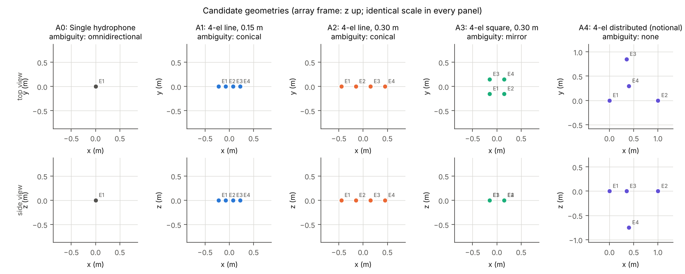
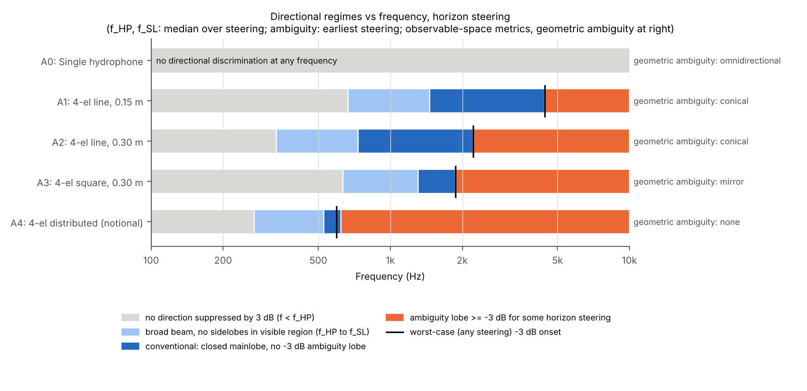
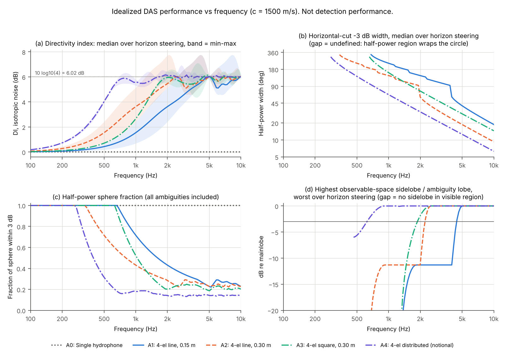
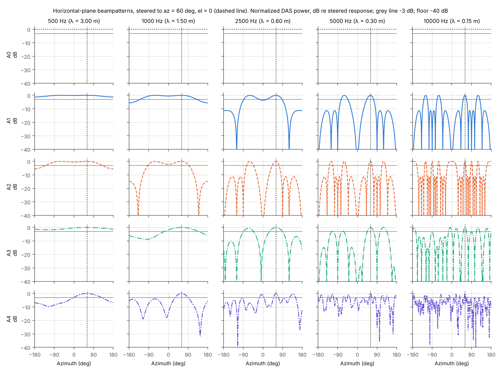
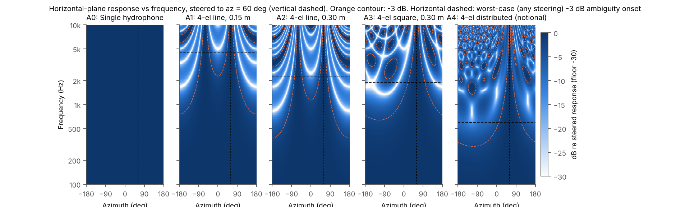
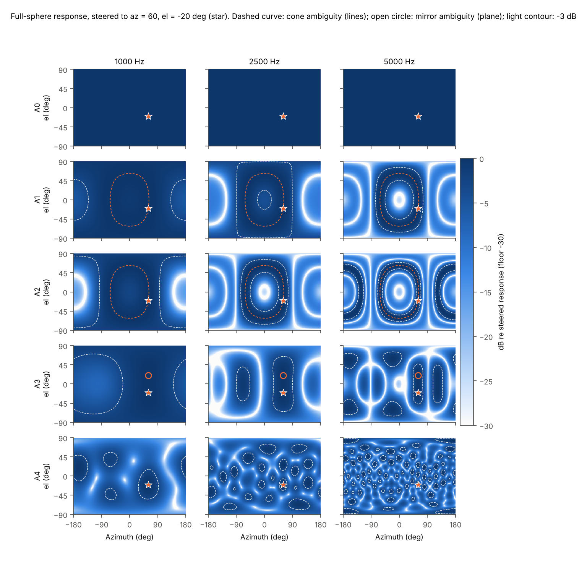
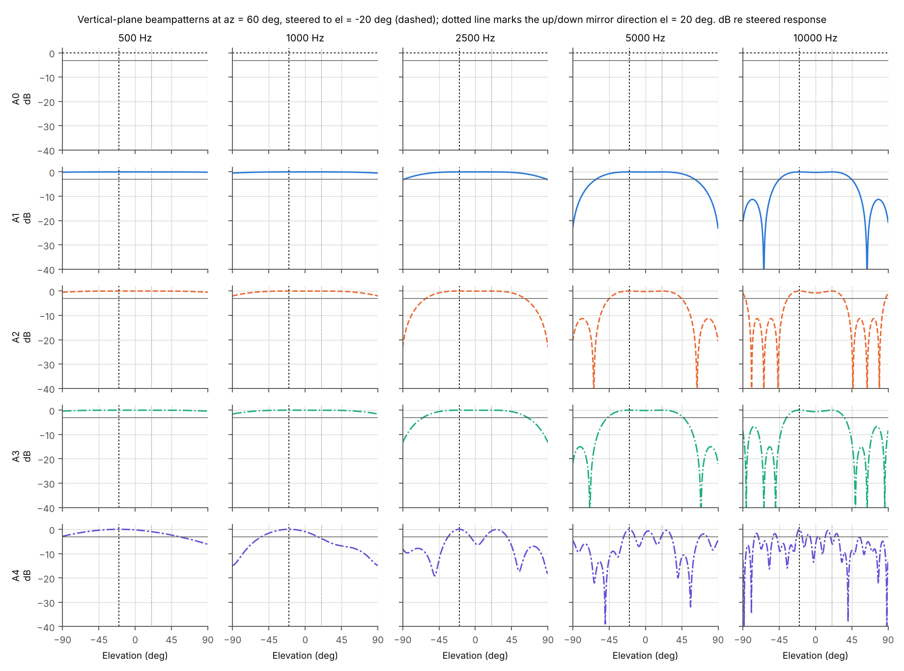
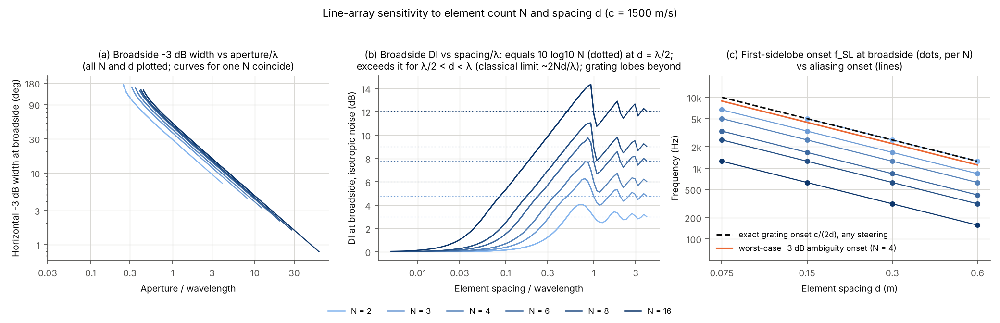
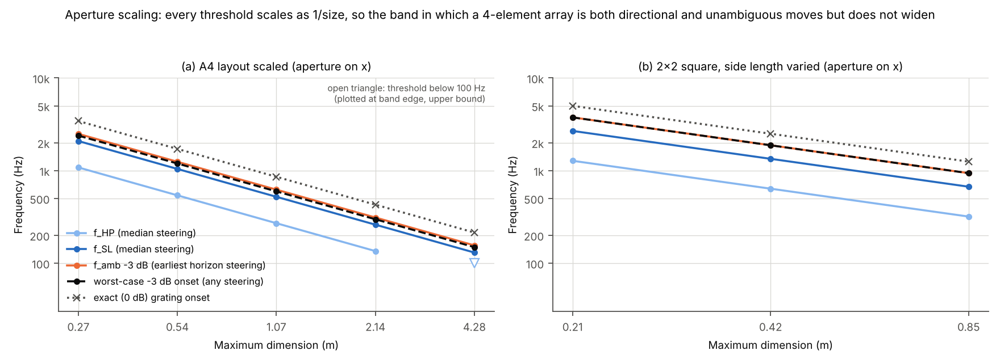
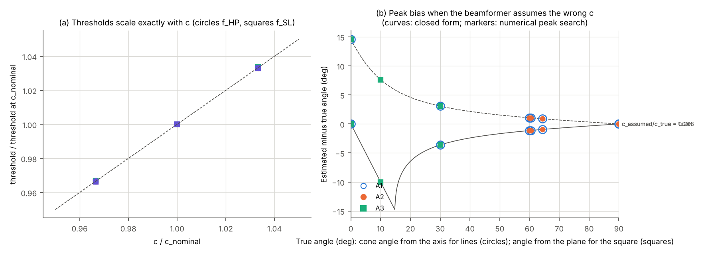

# PCK-SIM-001 / SIM-01 Engineering Report

**Array Geometry and Idealized Acoustic Performance of Candidate Picket Arrays**

| | |
|---|---|
| Program | Ulmo / Picket, PCK-SIM-001 |
| Increment | SIM-01 (array geometry, idealized narrowband performance) |
| Run of record | `20261107T203522Z_d64d297c_8043684` |
| Code | `picket_sim` 0.1.0, git `8043684` (clean tree) |
| Configuration | `configs/sim01/sim01_baseline.yaml` (sha256 `d64d297cb705eeae...`) |
| Reproduce | `make sim01` (equivalently `python -m picket_sim run configs/sim01/sim01_baseline.yaml`) |
| Status | Revision A. Accepted with documentation corrections (SIM-01 technical review, ADR-0008). Not a design selection. |

**Revision history**

| Rev | Date | Change |
|---|---|---|
| 0 | 2026-11-07 | Initial delivery (review package `deliverables/PCK-SIM-001_SIM-01_Review_Package_20261107T203522Z_d64d297c_8043684.zip`, retained unchanged). |
| A | 2026-11-07 | Documentation corrections from the SIM-01 technical review (ADR-0008): (1) 6.02 dB qualified as the white-noise gain of four equally weighted elements, not a bound on array gain; (2) f_HP described as a -3 dB discrimination criterion, not a limit on direction information; (3) median-steering bands separated from bands guaranteed across the steering set (`reports/SIM-01_band_definitions.md`); (4) narrowband grating lobes separated from broadband direction-finding performance; (5) Pareto conclusions stated as conditional and not a basis for eliminating hardware candidates. No experimental result was changed. |

All numbers in this report are read from the tables of the run of record
(`results/sim01/20261107T203522Z_d64d297c_8043684/tables/`). Figures are in `results/sim01/20261107T203522Z_d64d297c_8043684/figures/`. Confidence levels
refer to the statement *as a property of the stated model*; transfer to hardware is addressed
separately in Section 8.

---

## 0. Bottom line

1. **Uniform weighting of four elements gives 6.02 dB against spatially white noise, and much less
   against diffuse noise at low frequency.** The 6.02 dB figure is the white-noise gain (WNG) of four
   equally weighted elements, 10 log10 4. It is not a bound on array gain in general: other weights
   and other noise fields give different gains. Even uniform DAS exceeds it in diffuse noise for
   spacings between lambda/2 and lambda (7.71 dB for A2 at 2 kHz, best horizon steering), and
   adaptive or superdirective weights can exceed it further in correlated noise, at a cost in
   robustness that SIM-01 did not evaluate. Against spherically isotropic noise the band-median
   directivity index (DI) of uniform DAS from 100 Hz to 1 kHz is 0.17 dB (A1), 0.65 dB (A2),
   0.27 dB (A3) and 1.73 dB (A4). (Confidence: high for the model; realized gain depends on the
   noise field and sensor noise, see Section 8 and SIM-02A.)
2. **Half-power (-3 dB) discrimination by DAS exists only above a frequency set by aperture.** Below
   the half-power onset f_HP (median over horizon steering: A1 667 Hz, A2 334 Hz, A3 633 Hz,
   A4 270 Hz) no direction is attenuated by 3 dB relative to the look direction. f_HP is a -3 dB
   discrimination criterion for conventional beamforming. It is not a boundary below which direction
   information ceases to exist: the pattern still varies by less than 3 dB, the inter-channel phase
   differences still encode direction, and estimators operating at sufficient SNR, or broadband and
   TDOA methods, can extract it. (High, for the criterion as defined.)
3. **Four elements leave a narrow conventional band, narrowest once they are spread over two or
   three dimensions.** Bands depend on how steering directions are aggregated
   (`reports/SIM-01_band_definitions.md`). Over the horizon steering set, the band in which *every*
   steering direction has a closed mainlobe and no -3 dB ambiguity lobe (guaranteed band) is
   A1 2,501 to 4,432 Hz (ratio 1.77), A2 1,251 to 2,216 Hz (1.77), A3 1,465 to 1,877 Hz (1.28) and
   A4 586 to 623 Hz (1.06). For a typical (median) steering direction the band is wider: A1 1,465 to
   5,192 Hz (3.54), A2 733 to 2,596 Hz (3.54), A3 1,306 to 2,010 Hz (1.54), A4 527 to 717 Hz (1.36).
   Rev 0 of this report quoted a mixed convention (median f_SL to earliest f_amb: ratios 3.03, 3.03,
   1.44, 1.18), which is neither typical nor guaranteed. (High, for the -3 dB criterion.)
4. **Geometric ambiguity is exact and frequency independent.** Lines (A1, A2) see a cone: every
   horizontal target off the array axis has a 0 dB left/right mirror at every frequency. The horizontal square (A3) has a 0 dB
   up/down mirror. Only the volumetric A4 is free of geometric ambiguity, and A0 has no directional
   information at all. (High; mathematical.)
5. **Irregular placement does not prevent narrowband grating lobes in a 4-element volumetric array.**
   Any four non-coplanar sensors have exactly three independent baselines, which always generate a
   lattice; A4 therefore has exact 0 dB narrowband grating lobes from 857 Hz (worst-case steering),
   -3 dB ambiguity lobes from 596 Hz, and up to 276 lobes within 3 dB of the mainlobe at 10 kHz.
   This is a single-frequency result. It does not establish that broadband direction finding fails:
   grating-lobe directions move with frequency while the true direction does not, so broadband
   beamforming or TDOA processing can reject them, subject to bandwidth, SNR, coherence and timing
   synchronization (SIM-02B). (High for the narrowband statement; the broadband consequence is not
   evaluated.)
6. **A1 and A2 are one design at two scales.** Every A2 metric at frequency f equals the A1 metric at
   2f. Choosing between them is choosing a band, not a geometry. (High.)
7. **No candidate selection is supported by SIM-01, and no hardware candidate is eliminated.** The
   Pareto results are conditional on an attribute set that omits cost, installation, calibration
   burden and power. Within that set, no candidate is dominated on the full multichannel attributes,
   and A1 is dominated by A3 only on the reduced all-candidate set, which excludes aliasing onset.
   These results must not be used to eliminate candidates. The evidence indicates that 4-element
   *narrowband* DAS does not provide wideband, unambiguous, full-azimuth bearing under the -3 dB
   criterion; it is insufficient to choose among candidates until the sensing tasks, the processing
   (narrowband vs broadband/TDOA) and the noise environment are specified. (Moderate; depends on
   requirements not yet defined.)

---

## 1. Scope

**Modeled:** single-frequency plane waves from far-field sources; homogeneous, lossless, unbounded
medium (c = 1500 m/s nominal, 1450 to 1550 m/s for robustness); ideal identical omnidirectional
point hydrophones at exactly known positions; conventional uniformly weighted delay-and-sum (DAS);
ideal array gain against spherically isotropic and spatially white noise; sound-speed mismatch
between data and beamformer.

**Not modeled (by the handoff's exclusions or as SIM-01 idealizations):** ocean propagation and
boundaries, vessel self-noise and flow noise, structural acoustics, element directivity and hull
baffling, calibration and position errors, sensor electronic noise, broadband or time-difference
processing, adaptive or superdirective beamforming, detection range. Full register:
`docs/assumptions.md`.

**What the numbers are not:** none of the gains, beamwidths or thresholds here is detection
performance. DI is a geometry figure of merit in a model noise field.

---

## 2. Candidates

All candidates are defined in the configuration and pass through the same interface
(`ArrayGeometry` -> `PlaneWaveManifold` -> DAS -> metrics).

| ID | Configuration | N | Max dimension (m) | Min spacing (m) | Observable dims | Geometric ambiguity |
|---|---|---|---|---|---|---|
| A0 | Single hydrophone | 1 | 0 | n/a | 0 | omnidirectional |
| A1 | Line along x, 0.15 m spacing | 4 | 0.450 | 0.150 | 1 | conical |
| A2 | Line along x, 0.30 m spacing | 4 | 0.900 | 0.300 | 1 | conical |
| A3 | 2x2 square in the horizontal x-y plane, 0.30 m side | 4 | 0.424 | 0.300 | 2 | mirror (up/down) |
| A4 | Distributed, non-coplanar, irregular (notional placeholder) | 4 | 1.070 | 0.901 | 3 | none |

A4 coordinates (m): (0, 0, 0), (1.00, 0, 0), (0.35, 0.85, 0), (0.40, 0.30, -0.75). They are a
placeholder for elements spread around a small host and have no survey basis; Section 5.6 shows
how A4 conclusions scale with size. Orientation is an assumption: lines along x, square
horizontal. Figure: `fig01_geometries.png`.

*Figure 1. Candidate geometries, top and side views at a common scale.*

---

## 3. Method

### 3.1 Governing equations

Right-handed frame, metres, z up; azimuth from +x toward +y; elevation positive up; `u` is the unit
vector toward the source; time convention exp(+j omega t) (`docs/conventions.md`).

* wavelength lambda = c / f, wavenumber k = 2 pi f / c
* arrival-time offset tau_n = -(u . r_n) / c (sensors nearer the source receive first)
* steering vector a_n(u) = exp(+j k u . r_n)
* DAS weights steered to u0: w = a(u0) / N; normalized power P(u; u0) = |w^H a(u)|^2 / |w^H a(u0)|^2,
  so P = 1 (0 dB) in the steering direction by construction, never normalized to a grid maximum
* equivalently P = |W(k(u - u0))|^2 with array factor W(q) = (1/N) sum_n exp(j q . r_n)
* array gain AG = |w^H a0|^2 / (w^H Gamma w): Gamma = I gives WNG = N; Gamma_mn = sin(k r_mn)/(k r_mn)
  (spherically isotropic) gives DI

### 3.2 Geometric ambiguity, exactly

A phase common to all channels is unobservable, so P depends on u only through its projection onto
the span of the sensor difference vectors. The rank of that span (0 to 3) fixes the ambiguity
exactly and independently of frequency: rank 1 = cone about the line axis, rank 2 = mirror image
through the plane, rank 3 = none. Sidelobe and aliasing metrics are computed in this observable
space, so that a 0 dB cone or mirror image is reported as geometric ambiguity, not as a sidelobe.

### 3.3 Metrics (full definitions: `docs/metrics.md`)

* **DI** (dB), closed form; **WNG** = 10 log10 N.
* **HPSF**, the half-power sphere fraction: share of all directions within 3 dB of the steered
  response. Includes every ambiguity; 1.0 means no half-power discrimination anywhere.
* **HPBW_h / HPBW_v**: -3 dB widths on the horizontal and vertical great circles through the
  steering direction; undefined (shown as `inf` in medians) when the half-power region wraps the
  circle.
* **PSL_obs**: highest non-mainlobe lobe in the observable space; undefined when no sidelobe exists
  in the visible region.
* **Regime thresholds per steering direction**: f_HP (first direction 3 dB down), f_SL (first
  sidelobe region; the mainlobe no longer fills the visible region), f_amb(L) (first observable
  ambiguity lobe at or above L dB).
* **Worst case over all steering**: f_alias(L) from the array factor in wavevector space
  (|q| <= 2k), and the exact (0 dB) grating onset from the reciprocal lattice of the baselines.

Statistics are taken over a horizon ring (el = 0, 24 azimuths) and a depressed ring (el = -30 deg).
The frequency grid is 121 log-spaced points from 100 Hz to 10 kHz; thresholds are refined by
bisection to 0.1 %.

### 3.4 Numerical methods and verification

* Sphere integrals: Gauss-Legendre (181 nodes in sin el) x 360 azimuths, exact for the band-limited
  patterns involved. Cuts: 0.1 deg. Line arrays: 4001-point grid in the observable coordinate.
* Local maxima: neighbour comparison on the grid (wrapping azimuth and poles), then iterative zoom
  refinement.
* **Verification suite: 131 tests, all passing on the run-of-record commit.** Highlights:
  hand-computed steering vectors on all three axes; the far-field limit of an exact spherical
  wave; a time-domain delayed-pulse FFT check of the delay sign; closed-form Dirichlet patterns;
  broadside symmetry; broadside and endfire null positions; cone and mirror invariances under
  random rotations and reflections; translation invariance; DI quadrature vs closed form for all
  candidates; DI = 10 log10 N at half-wavelength spacing; single-hydrophone non-directionality at
  every frequency; the exact half-power beamwidth from an independent root; the N = 4 first
  sidelobe (-11.30 dB) against brute force; grating lobe exactly at c/(2d); worst-case aliasing
  onset against independent line and square derivations; f_SL = c/(Nd); f_HP = c/(8d) for a pair at
  endfire; f/c scaling; sound-speed mismatch against closed form; unit-error rejection; plotting
  orientation and normalization; byte-identical outputs from two identical end-to-end runs.
* **Self-checks embedded in the run of record** (`record.json`):
    * DI closed form versus sphere quadrature: max |difference| 1.3e-13 dB (tolerance 0.01 dB) over all 29,040 sweep rows.
    * Normalized power at the steering direction: max |P(u0) - 1| = 2.2e-16.
    * Exact grating onset (reciprocal lattice) versus c/(2d) for the declared lattices: max relative difference 2.2e-16.
    * Worst-case aliasing onset never exceeds a steering-specific onset (max relative excess 0.0).
    * Threshold scaling with sound speed: max deviation from the exact ratio c/c0 = 4.2e-04 (bisection tolerance 1e-3).
    * Line-array HPSF, exact 1-D value versus sphere-grid quadrature: max |difference| 0.0024 (grid resolution effect, informational).
    * Rows with fewer than 4 grid samples per lobe width: 0. Warnings: none.

### 3.5 Errors found and corrected during SIM-01

Recorded for traceability (`results/sim01/ERRATA.md`). The first complete run
(`20261107T200834Z_cf0574c6_059a354`, retained unmodified) contained a floating-point artifact.
The sphere-quadrature HPSF could read 1 + 2e-16, and without a tie tolerance in the Pareto
comparison this kept A1 off the dominated list. It also had two figure annotation errors and
lacked the exact grating onset for A4. All other numbers in that run are identical to the run of
record (Section 9).

---

## 4. Results

### 4.1 Directional regimes (the central result)

`fig07_regime_map.png`; `tables/thresholds_summary.md`.

*Figure 2. Directional regimes versus frequency (horizon steering).*

| ID | f_HP best / median / worst (Hz) | f_SL earliest / median / latest (Hz) | f_amb -3 dB earliest / median (Hz) | f_amb -3 dB any steering (Hz) | Exact grating, any steering (Hz) |
|---|---|---|---|---|---|
| A1 | 569 / 667 / 1,139 | 1,251 / 1,465 / 2,501 | 4,432 / 5,192 | 4,432 | 5,000 |
| A2 | 285 / 334 / 569 | 625 / 733 / 1,251 | 2,216 / 2,596 | 2,216 | 2,500 |
| A3 | 625 / 633 / 644 | 1,251 / 1,306 / 1,465 | 1,877 / 2,010 | 1,876 | 2,500 |
| A4 | 253 / 270 / 298 | 450 / 527 / 586 | 623 / 717 | 596 | 857 |

Conventional bands, horizon steering set (`reports/SIM-01_band_definitions.md`; frequencies in Hz):

| ID | Guaranteed: latest f_SL to earliest f_amb (ratio) | Median: median f_SL to median f_amb (ratio) | Rev 0 convention: median f_SL to earliest f_amb (ratio) |
|---|---|---|---|
| A1 | 2,501 to 4,432 (1.77) | 1,465 to 5,192 (3.54) | 1,465 to 4,432 (3.03) |
| A2 | 1,251 to 2,216 (1.77) | 733 to 2,596 (3.54) | 733 to 2,216 (3.03) |
| A3 | 1,465 to 1,877 (1.28) | 1,306 to 2,010 (1.54) | 1,306 to 1,877 (1.44) |
| A4 | 586 to 623 (1.06) | 527 to 717 (1.36) | 527 to 623 (1.18) |

The guaranteed band holds for every sampled horizon steering direction; the median band holds for a
typical one. For the depressed (el = -30 deg) ring the A4 guaranteed band is empty. Bands are for
the -3 dB criterion; stricter ambiguity criteria narrow them further (evaluated in SIM-02A).

Reading the regimes (all statements refer to conventional DAS and the stated -3 dB criteria):

* **f < f_HP:** no direction is attenuated by 3 dB relative to the look direction, so DAS gives no
  -3 dB discrimination. Direction information is still present in the inter-channel phases and can
  be extracted by other estimators at sufficient SNR.
* **f_HP to f_SL:** a broad beam with no nulls in the visible region.
* **f_SL to f_amb:** conventional beamforming, a closed mainlobe and no ambiguity lobe at -3 dB
  (within the geometric ambiguity class).
* **Above f_amb:** narrowband ambiguity lobes within 3 dB of the mainlobe for at least one horizon
  steering direction. Above the exact grating onset they are 0 dB narrowband copies of the mainlobe
  for some steering. Broadband processing can separate them (Section 4.4).

For a line steered broadside the thresholds have closed forms that the run reproduces. f_SL = c/(Nd)
(measured f_SL x N d / c = 1.0005 for every N and d in the sensitivity study). Half-power
discrimination begins when the aperture (N - 1) d reaches 0.25 lambda (N = 2), 0.34 lambda (N = 4) or
0.42 lambda (N = 16). Endfire steering halves both thresholds.

### 4.2 Array gain: single channel versus multichannel

`fig06_metrics_vs_frequency.png` (a); `tables/comparison.md`.

*Figure 3. DI, horizontal half-power width, half-power sphere fraction and worst observable ambiguity lobe versus frequency.*

| ID | WNG (dB) | DI median 0.1-1 kHz (dB) | DI median 1-3 kHz (dB) | DI median 3-10 kHz (dB) |
|---|---|---|---|---|
| A0 | 0.00 | 0.00 | 0.00 | 0.00 |
| A1 | 6.02 | 0.17 | 3.19 | 5.48 |
| A2 | 6.02 | 0.65 | 5.09 | 5.81 |
| A3 | 6.02 | 0.27 | 5.48 | 5.90 |
| A4 | 6.02 | 1.73 | 5.95 | 6.00 |

* The 6.02 dB WNG is the gain of four equally weighted elements against spatially white
  (uncorrelated, equal-power) sensor noise, independent of geometry. Equal weights maximize gain
  against white noise, so no weighting does better in that noise field; in correlated noise fields
  other weights can do better or worse. Doubling N adds 3 dB of WNG; going from 4 to 16 elements
  adds 6 dB.
* Against diffuse noise, gain collapses when sensors are closer than about lambda/2, because the
  noise at the sensors is then correlated. DAS DI can exceed 10 log10 N for spacings between lambda/2
  and lambda (negatively correlated noise). The line-array study reaches about 7.7 dB for N = 4 and
  14.3 dB for N = 16 at d/lambda near 0.8 to 0.93 on the analysis grid (`fig08` (b)), consistent with
  the classical long-line value 2L/lambda. That regime sits immediately below grating-lobe onset.
* DI says nothing about ambiguity. A4 holds a median DI of 5.94 to 6.10 dB at 2, 2.5, 5 and
  10 kHz while carrying 12 to 276 ambiguity lobes within 3 dB of the mainlobe. Gain and direction
  finding must be assessed separately.

### 4.3 Beampatterns and resolution

`fig02_horizontal_beampatterns.png`, `fig03_vertical_beampatterns.png`,
`fig04_frequency_azimuth_maps.png`, `fig05_sphere_ambiguity_maps.png`;
`tables/representative_frequencies.md`.

*Figure 4. Horizontal-plane beampatterns at representative frequencies, steered to az = 60 deg.*

*Figure 5. Horizontal-plane response versus frequency (steered to az = 60 deg) with the -3 dB contour.*

*Figure 6. Full-sphere response for a target at az = 60, el = -20 deg: cone (lines), mirror (square) and lattice aliasing (A4).*

*Figure 7. Vertical-plane beampatterns through the same target; dotted line marks the up/down mirror elevation.*

Median horizontal half-power width over horizon steering (deg):

| ID | 500 Hz | 1 kHz | 2.5 kHz | 5 kHz | 10 kHz |
|---|---|---|---|---|---|
| A1 | undefined | 231 | 116 | 40.5 | 18.8 |
| A2 | 231 | 139 | 40.5 | 18.8 | 9.3 |
| A3 | undefined | 157 | 58.8 | 29.1 | 14.5 |
| A4 | 135 | 63.9 | 25.2 | 12.6 | 6.3 |

* Widths above 180 deg for the lines are not errors. The half-power region on the horizon merges
  the target with its left/right mirror, so the 0 dB mirror lobe makes "width" a measure of the
  merged lobe pair. The step changes in `fig06` (b) occur where the mainlobe separates from the
  mirror lobe for successive steering directions.
* The horizontal-plane width falls as lambda/aperture. A4 is narrowest because it has the largest
  aperture, which is the same property that makes it alias earliest.
* Vertical resolution of the horizontal square is poor near the horizon. The median HPBW_v for
  horizon steering is 137 deg at 2 kHz and 83 deg at 5 kHz, because cos(el) is stationary at el = 0.

### 4.4 Ambiguity and aliasing

* **A1, A2 (cone).** For every horizon steering direction except exact endfire (where the mirror
  coincides with the target), and at every one of the 121 frequencies, the horizontal cut carries a
  lobe outside the mainlobe at 0 dB to within 2e-15 dB: the mirror at -az. On the depressed ring the
  vertical cut shows the 0 dB up/down image. A line array alone cannot provide unambiguous
  horizontal bearing or any 3-D direction. Aliasing: -3 dB lobes from 4,432 Hz (A1) and 2,216 Hz (A2)
  for near-endfire steering; at broadside the A1 -3 dB ambiguity onset is 8,865 Hz (line-array
  sensitivity table).
* **A3 (mirror).** Azimuth is geometrically unambiguous. For every source 30 deg below the horizon,
  at every frequency, the vertical cut has a 0 dB lobe (to within 2e-15 dB) at the mirror elevation
  +30 deg. Aliasing from 1,877 Hz (-3 dB) and
  2,500 Hz (0 dB); the number of -3 dB ambiguity lobes reaches 20 at 10 kHz (horizon ring maximum).
* **A4 (none, but lattice aliasing).** From 900 Hz to 10 kHz the worst observable ambiguity lobe over
  horizon steering is within 0.08 dB of the mainlobe at every analysed frequency. The maximum number of lobes at or above -3 dB is 3 at 1 kHz, 12 at 2 kHz,
  71 at 5 kHz and 276 at 10 kHz. The exact grating lobes follow from the reciprocal lattice of A4's
  three baselines (onset 857 Hz). This holds for *any* 4-element non-coplanar layout: irregularity
  changes where the lattice points lie, not whether they exist (tests draw random layouts and find
  |W| = 1 exactly). Aperiodic layouts suppress grating lobes only when N is well above rank + 1;
  a generic 5-element volumetric layout has none (test).
* **A0.** Omnidirectional at every frequency (HPSF = 1.0, all pattern metrics undefined).

Narrowband scope: every ambiguity and grating-lobe statement in this section is a single-frequency
property of the conventional beampattern. Exact narrowband grating lobes do not establish broadband
direction-finding failure. For broadband signals the grating-lobe directions move with frequency
while the true direction does not, so broadband beamforming or TDOA processing can reject ambiguity
that a narrowband pattern shows at 0 dB, provided bandwidth, SNR, signal coherence across the array
and inter-channel timing are adequate. This matters most for A4-like distributed layouts. It is not
evaluated in SIM-01 and is assigned to SIM-02B.

### 4.5 Sensitivity to element count, spacing and aperture

`fig08_line_array_sensitivity.png`, `fig09_aperture_scaling.png`;
`tables/sensitivity_*.md`.

*Figure 8. Line-array sensitivity to element count and spacing.*

*Figure 9. Threshold scaling with aperture for the A4 layout and the 2x2 square.*

* **Aperture sets resolution; spacing sets aliasing; element count sets the ratio between them.**
  For lines, broadside HPBW collapses onto a single curve of aperture/lambda for each N (`fig08` (a)).
  The broadside first-sidelobe onset is c/(Nd) and the worst-case grating onset c/(2d), so the
  conventional band ratio is N/2 for worst-case steering: 2 for N = 4, 8 for N = 16.
* **Scaling a fixed shape moves every threshold as 1/size and leaves their ratios unchanged.**
  A4 scaled from 0.27 m to 4.28 m maximum dimension moves f_SL from 2,084 Hz to 130 Hz and the -3 dB ambiguity onset
  from 2,491 Hz to 156 Hz. The square with side 0.15, 0.30, 0.60 m has f_SL 2,680 / 1,340 / 670 Hz and
  -3 dB onset 3,754 / 1,877 / 938 Hz (30 deg steering step). No choice of scale widens a 4-element
  array's conventional band. Only more elements do.
* **Orientation decides which angle is lost** (`tables/sensitivity_orientation.md`). A vertical line
  (A1-V) has no azimuth discrimination at any frequency (HPBW_h undefined for every horizon
  steering at 1, 2 and 5 kHz). A square in the vertical x-z plane (A3-V) trades the up/down mirror
  for a 0 dB port/starboard mirror on the horizon.

### 4.6 Robustness to sound speed

`fig10_sound_speed_robustness.png`; `tables/robustness_sound_speed*.md`.

*Figure 10. Sound-speed scaling of thresholds and peak bias under sound-speed mismatch.*

* **Thresholds scale exactly with c**, as the model depends only on f/c. Over 1450 to 1550 m/s every
  threshold moves by -3.3 % to +3.3 % (largest deviation from the exact ratio: 4.2e-04). The ordering
  of candidates on every threshold is unchanged across the range.
* **Mismatch between the true and assumed sound speed biases the peak deterministically**, matching
  the closed form p_est = (c_assumed / c_true) p_true in the observable space:
    * Lines: zero bias at broadside and growing toward endfire. For c_true = 1550 m/s with 1500 assumed,
      the bias is +1.06 deg at 60 deg from the axis, +3.06 deg at 30 deg and +14.59 deg at endfire.
      For c_true = 1450, sources within 14.8 deg of endfire are reported at endfire.
    * Horizontal square: azimuth is unbiased (0.00 deg). Elevation is strongly biased near the horizon:
      a horizon source is reported at |el| = 14.59 deg when c_true = 1550, and a source at -10 deg is
      reported at the horizon when c_true = 1450.
    * A4: direction error at most 0.36 deg over the cases evaluated.

Elevation from a horizontal planar array therefore needs in-situ sound speed: a cheap sensor, but a
real requirement.

---

## 5. Engineering assessment

### 5.1 How much useful spatial performance is gained by adding array elements?

* **Conventional SNR gain is small and grows logarithmically.** The white-noise gain of N equally
  weighted elements is 10 log10 N (6.02 dB at N = 4). Against diffuse noise, uniform DAS on the
  4-element candidates gives 0.2 to 1.7 dB below 1 kHz (band medians) and approaches 6 dB only above
  roughly 2 to 3 kHz. Other weightings and noise fields give different gains (Section 0, item 1).
  Confidence: high (model); realized gain depends on sensor and ambient noise (SIM-02A).
* **Going from 1 to 4 elements buys -3 dB conventional discrimination in a band.** A0 has no
  directional response at any frequency. The 4-element candidates provide half-power discrimination
  only above 270 to 667 Hz (median steering). Conventional beamforming free of -3 dB ambiguity lobes
  holds over guaranteed bands of 1.06:1 to 1.77:1 and median bands of 1.36:1 to 3.54:1
  (Section 4.1). Direction information below f_HP and broadband rejection of narrowband ambiguity
  are not captured by these criteria. High, for the criteria as defined.
* **More elements at fixed spacing** extend the aperture and lower f_HP and f_SL in proportion,
  without moving the aliasing onset. **More elements at fixed aperture** raise the aliasing onset
  without improving resolution. **Every doubling of N doubles the unambiguous band ratio** (N/2 for
  lines) and adds 3 dB of WNG. High.

### 5.2 Which geometries show meaningful advantages in which frequency regions?

| Band | Observations (horizon targets) |
|---|---|
| 100 to ~250 Hz | No candidate reaches -3 dB DAS discrimination (every f_HP is above the band; A4's best is 253 Hz). Direction information below this criterion is not assessed. |
| ~250 to ~700 Hz | A4 and A2 reach -3 dB discrimination. A4 is free of -3 dB ambiguity lobes in 3-D only up to ~600 Hz (623 Hz earliest horizon onset); A2's beam is broad (HPBW_h 231 deg at 500 Hz) and conical. |
| ~0.7 to ~2.2 kHz | A2 is in its conventional regime for median steering (733 to 2,596 Hz) and for every horizon steering direction from 1,251 to 2,216 Hz (conical ambiguity remains). A3 is conventional for every horizon steering direction from 1,465 to 1,877 Hz (1,306 to 2,010 Hz for median steering) and is the only candidate with full-circle azimuth observability there. |
| ~1.5 to ~4.4 kHz | A1 is conventional for median steering (1,465 to 5,192 Hz) and for every horizon steering direction from 2,501 to 4,432 Hz (conical). A2, A3 and A4 have narrowband -3 dB ambiguity lobes for some steering. |
| > 4.4 kHz | Every multichannel candidate has narrowband -3 dB ambiguity lobes for some horizon steering. A1 stays clean only for steering away from endfire (until 8.9 kHz at broadside). |

Under the -3 dB narrowband criterion no candidate's conventional band exceeds a factor of 1.77 for
every steering direction, or 3.54 for a median direction. The candidates that remove left/right
ambiguity (A3, A4) have guaranteed bands of 1.28 and 1.06. Confidence: high for the stated model and
criteria; broadband processing is not assessed.

### 5.3 Where do compact arrays fundamentally lose directional discrimination? (question as posed)

Conventional DAS loses -3 dB discrimination below f_HP, where the aperture is less than about 0.25 to
0.42 wavelengths for a broadside line (half that at endfire). For the candidates (best to worst
horizon steering): A1 below 569 to 1,139 Hz, A3 below 625 to 644 Hz, A2 below 285 to 569 Hz, A4
below 253 to 298 Hz. Between f_HP and f_SL (aperture below about one wavelength) the beam is wider
than the visible region and has no nulls, so DAS can neither reject a strong interferer nor resolve
two sources.

These are limits of conventional beamforming under a -3 dB criterion, not limits on direction
information. Below f_HP the beampattern still varies with direction by less than 3 dB and the
inter-channel phase differences still encode the arrival direction; their usefulness depends on SNR,
calibration and timing accuracy, which SIM-02A models. Ways to use that information, or to exceed the
conventional limits, include larger aperture, phase-difference or TDOA estimators, superdirective or
adaptive weighting (which trade white-noise gain and robustness to calibration error), and sensors
with intrinsic directivity such as acoustic vector sensors. None was evaluated here. Confidence: high
for the -3 dB criterion; the achievable performance of other estimators is not assessed.

### 5.4 Which configurations have serious ambiguity or aliasing problems?

* **A4: severe narrowband aliasing.** Exact 0 dB narrowband grating lobes from 857 Hz (worst case)
  and -3 dB lobes from 596 Hz; hundreds of near-0 dB lobes at 10 kHz. Single-frequency DAS on A4 does
  not give unambiguous bearing above about 0.6 kHz. The lattice structure is generic to 4-element
  volumetric arrays. Whether broadband or TDOA processing resolves these ambiguities is not
  established by SIM-01 (SIM-02B).
* **A1, A2: severe geometric ambiguity** (cone: total left/right ambiguity for horizontal targets) at
  all frequencies, plus aliasing above 4.4 kHz (A1) and 2.2 kHz (A2) for near-endfire steering
  (A1 at broadside: -3 dB ambiguity onset 8,865 Hz).
* **A3: mirror ambiguity** at all frequencies (benign only if all targets are known to be on one side
  of the plane; surface-reflected arrivals come from the mirror side) and aliasing from 1.9 kHz.
* **A0: no direction at all.**

Confidence: high.

### 5.5 Which conclusions are robust to reasonable changes in sound speed and geometry?

| Conclusion | Robust to c (1450 to 1550 m/s) | Robust to scale | Robust to orientation / A4 coordinates |
|---|---|---|---|
| Geometric ambiguity class of each candidate | Yes (independent of c) | Yes | Class yes; *which* angle is lost depends on orientation |
| Existence of exact narrowband grating lobes for 4-element arrays | Yes | Yes | Yes for any 4-element layout (mathematical); broadband consequence not assessed |
| Conventional band ratios (median and guaranteed definitions) | Yes (exactly invariant) | Yes (invariant) | Depends on shape, not on size |
| Absolute threshold frequencies | Shift by +-3.3 % | No: scale as 1/size | A4 values specific to placeholder coordinates |
| Ordering of candidates on each threshold | Yes (verified) | Only for these sizes | Not established for other layouts |
| DI fine structure (dips and peaks) | Shifts with f/c | Shifts with size | Not robust; do not use for selection |
| Elevation estimates from horizontal planar arrays | **No**: 3 % sound-speed error gives up to ~15 deg near the horizon | | |

### 5.6 Which additional physical parameters must be modeled before selecting a preliminary architecture?

In priority order:

1. **Mission requirements:** frequency band(s) of interest, signal type (tonal versus broadband),
   required bearing accuracy and coverage (azimuth only versus 3-D), acceptable ambiguity. Without a
   band, aperture cannot be chosen, because every SIM-01 threshold scales with size.
2. **Processing model:** broadband and TDOA (cross-correlation) direction finding, bandwidth and
   integration time. These determine whether narrowband aliasing (A4, and A1 to A3 above their
   onsets) is fatal or manageable.
3. **Noise field:** sensor and preamplifier self-noise against ambient levels (where diffuse ambient
   dominates, the realized gain approaches DI rather than the WNG); ambient directionality (surface and
   shipping noise); flow noise at host speeds; host machinery and propeller noise and its spatial
   coherence across the array. Real array gain is AG with these coherence matrices, not DI.
4. **Host installation:** available mounting area and orientation per host class, baffling and
   shadowing by the hull, element directivity, scattering from nearby structure, and the near-field
   range for large apertures (Fraunhofer distance 15 m for A4 at 10 kHz).
5. **Calibration and synchronization:** gain and phase matching, position knowledge (phase error k
   times position error), and for distributed modules clock synchronization (a timing error dt is a
   phase error 2 pi f dt). These set the achievable sidelobe floor and null depth.
6. **Propagation and boundaries:** surface image arrivals (which arrive from the up/down mirror
   direction of a horizontal plane), multipath and refraction; in-situ sound speed for elevation
   (Section 4.6).
7. **Alternatives the candidate set omits:** acoustic vector sensors (directional from a single
   point, with an ideal first-order DI limit of 10 log10 4 = 6.02 dB that does not depend on
   aperture); planar or volumetric arrays with N > 4 (for example 6 to 8 elements on a circle);
   superdirective processing with explicit WNG constraints.
8. **Cost and complexity per channel and per module**, needed for a real Pareto analysis. SIM-01
   uses channel count and maximum dimension only as proxies.

---

## 6. Comparative results and Pareto analysis

`tables/comparison.md`, `tables/pareto.md`, `tables/pareto_leave_one_out.md`.

| ID | N | Max dim (m) | Geometric ambiguity | WNG (dB) | DI 0.1-1 kHz (dB) | DI 1-3 kHz (dB) | DI 3-10 kHz (dB) | HPSF 0.1-1 kHz | HPSF 1-3 kHz | HPSF 3-10 kHz | HPBW_h 1 kHz (deg) | HPBW_h 2.5 kHz (deg) | HPBW_h 5 kHz (deg) | f_HP (Hz) | f_SL (Hz) | f_amb -3 dB horizon (Hz) | f_amb -3 dB any steering (Hz) | Exact grating onset (Hz) |
|---|---|---|---|---|---|---|---|---|---|---|---|---|---|---|---|---|---|---|
| A0 | 1 | 0.00 | omnidirectional | 0.0 | 0.00 | 0.00 | 0.00 | 1.00 | 1.00 | 1.00 | inf | inf | inf | n/a | n/a | n/a | n/a | n/a |
| A1 | 4 | 0.45 | conical | 6.0 | 0.17 | 3.19 | 5.48 | 1.00 | 0.48 | 0.27 | 231 | 116 | 41 | 667 | 1,465 | 4,432 | 4,432 | 5,000 |
| A2 | 4 | 0.90 | conical | 6.0 | 0.65 | 5.09 | 5.81 | 1.00 | 0.31 | 0.24 | 139 | 41 | 19 | 334 | 733 | 2,216 | 2,216 | 2,500 |
| A3 | 4 | 0.42 | mirror | 6.0 | 0.27 | 5.48 | 5.90 | 1.00 | 0.24 | 0.21 | 157 | 59 | 29 | 633 | 1,306 | 1,877 | 1,876 | 2,500 |
| A4 | 4 | 1.07 | none | 6.0 | 1.73 | 5.95 | 6.00 | 0.79 | 0.15 | 0.14 | 64 | 25 | 13 | 270 | 527 | 623 | 596 | 857 |

* DI: directivity index vs spherically isotropic noise (ideal DAS), median over horizon steering, then median over frequencies in the band. Not detection performance.
* HPSF: fraction of all directions within 3 dB of the steered response (includes every ambiguity); 1.0 = no half-power discrimination anywhere.
* HPBW_h: half-power width on the horizontal great circle, median over horizon steering; inf = half-power region wraps the circle for most steering directions (includes merged left/right mirror lobes for line arrays).
* WNG: white-noise gain of uniform DAS = 10 log10 N, independent of geometry and frequency.

**Pareto dominance** (conditional on the attributes evaluated in SIM-01 only; cost, installation,
calibration burden and power are not evaluated; attribute lists in the configuration). These results
describe trade-offs within the idealized model. They are not a basis for eliminating any hardware
candidate.

| Attribute set | Attributes | Dominated (numerical ties) | Dominated (engineering tolerances) |
|---|---|---|---|
| all_candidates (A0 to A4) | channels, maximum dimension, observable dimensions, DI and HPSF band medians (low, mid, high) | A1 (by A3) | A1 (by A3) |
| multichannel (A1 to A4) | the above plus median f_HP and worst-case -3 dB ambiguity onset | none | none |

Leave-one-attribute-out (`tables/pareto_leave_one_out.md`): in the multichannel set, dropping the
worst-case ambiguity onset makes A1 dominated by A3; dropping any other single attribute dominates
nothing. In the all_candidates set, dropping maximum dimension makes A4 dominate A1, A2 and A3
(A1 is also dominated by A2 and A3), and dropping the low-band DI makes A3 dominate A2 as well as A1.

Interpretation: on the attributes defined for every candidate (channels, maximum dimension,
observable dimensions, DI and HPSF band medians) A3 is at least as good as A1 everywhere. A1 survives
only when the worst-case aliasing onset is included (4.43 kHz versus 1.88 kHz for A3). A0 is never
dominated because it has the fewest channels and no size, which says nothing about its usefulness for
bearing. The absence of further dominance reflects real trade-offs: aperture versus aliasing, and
geometric observability versus usable band. Every dominance statement here would change if cost,
installation constraints, calibration burden, power or broadband performance were added, and the
engineering tolerances are provisional (ADR-0008). A1 is therefore retained as a candidate.

---

## 7. Candidates that warrant further simulation

These recommendations cover what to simulate next. They are not a design selection.

1. **A0 (single hydrophone)**: keep as the detection-only, lowest-cost reference against which every
   multichannel option must justify its channels.
2. **The line family (A1/A2) as one candidate parameterized by spacing**: keep only if the
   requirement tolerates left/right ambiguity, or if host motion or a second orthogonal line can
   resolve it. Treat spacing as the band-selection parameter.
3. **The planar family (A3 class)**: keep for full-azimuth bearing. The 2x2 configuration has a narrow
   conventional band (1.28:1 guaranteed, 1.54:1 median, horizon steering). Add planar candidates with
   more elements (for example uniform circular arrays of 6 to 8 elements, or a 3x3 grid) at the same
   footprint.
4. **The distributed/volumetric family (A4 class)**: evaluate together with broadband/TDOA processing
   and a synchronization model. Single-frequency DAS at this size has narrowband ambiguity lobes above
   about 0.6 kHz; broadband performance is open. Replace the placeholder coordinates with surveyed
   host positions when available.
5. **Add acoustic vector sensors** as a candidate class before architecture selection, because they
   attack the low-frequency aperture limit that dominates every pressure-array result here.

Insufficient evidence: SIM-01 cannot rank these families without the mission band, the processing
approach and the noise environment (Section 5.6).

---

## 8. Limitations and unresolved questions

* **Idealization:** no noise model beyond the isotropic and white references, perfect calibration,
  point omnidirectional elements, free field. Real sidelobe floors, null depths and gains will be
  worse; the size of that loss is unknown until SIM-02 adds error and noise models.
* **Narrowband only.** The aliasing conclusions describe single-frequency patterns and are
  conservative for broadband processing; they do not establish broadband direction-finding failure.
* **Criteria, not limits.** f_HP, f_SL and f_amb are thresholds of conventional DAS under stated dB
  criteria. They do not bound the direction information available to other estimators.
* **Pareto results are conditional** on the evaluated attributes and provisional tolerances; no
  candidate is eliminated on their basis.
* **Metric thresholds** (-3 dB half power, -1/-3 dB ambiguity) are conventions. A detection-oriented
  requirement may need stricter ambiguity levels (-6 or -10 dB), which would narrow every conventional
  band reported here.
* **Steering statistics** use horizon and 30 deg-depressed rings. Worst-case-over-all-steering
  quantities are reported separately and are independent of this choice.
* **A4 is a placeholder.** Its generic conclusion (exact grating lobes for N = 4) is robust; its
  specific thresholds are not.
* **Open questions for the program:** mission band and signal types; whether bearing must be
  unambiguous in full azimuth or 3-D; whether hosts can turn to resolve ambiguity; acceptable
  per-channel cost; achievable inter-module timing synchronization for distributed installations.

---

## 9. Reproducibility and provenance

* `make sim01` runs the verification suite and then the experiment into a new directory
  `results/sim01/<run_id>/`. Runs refuse a dirty working tree and never overwrite.
* `record.json` in the run directory lists the resolved configuration and its hash, git commit,
  Python, NumPy and Matplotlib versions, platform, timings, self-checks and the SHA-256 of every
  output file. Pinned dependencies: `requirements.lock`.
* `results/sim01/RUN_INDEX.csv` lists every run. `results/sim01/ERRATA.md` records known problems
  in historical runs.
* Cross-run consistency: The first complete run (`20261107T200834Z_cf0574c6_059a354`, code `059a354`) and the run of record share 26 tables. 16 are byte-identical, including the full 29,040-row sweep, all regime thresholds, the sensitivity sweeps and the robustness tables. The other 10 differ only by the added exact-grating column, the corrected Pareto result and their Markdown renderings. Every numeric value present in both runs is identical.
