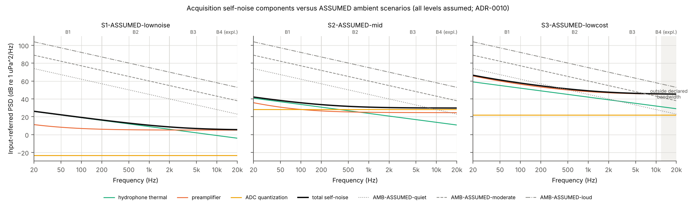
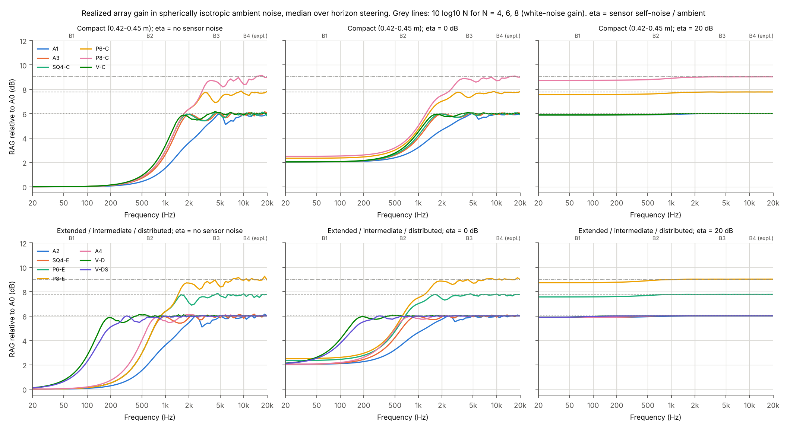
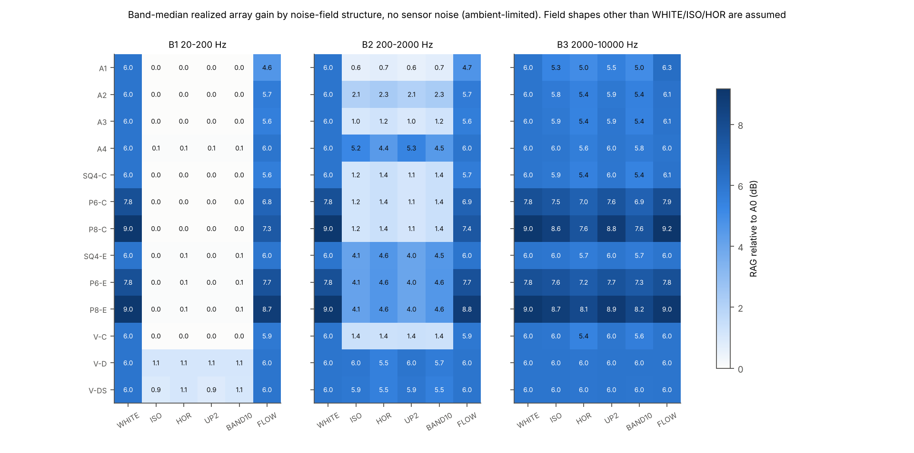
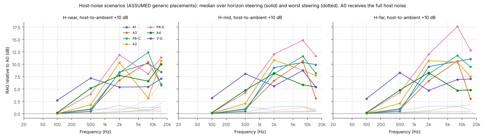
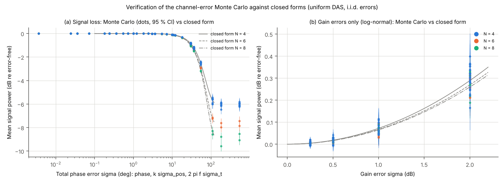
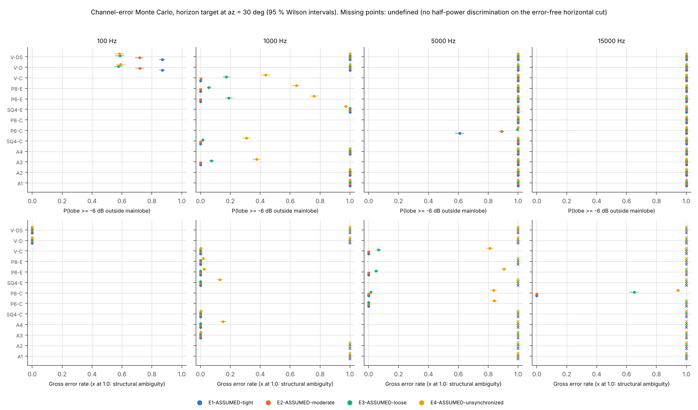
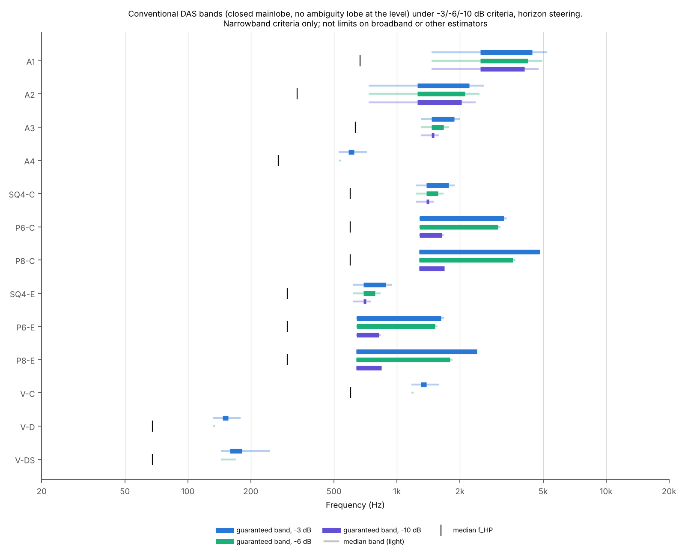

# PCK-SIM-001 / SIM-02A Engineering Report

**Sensor, Noise and Error Modeling for Candidate Picket Arrays**

| | |
|---|---|
| Program | Ulmo / Picket, PCK-SIM-001 |
| Increment | SIM-02A (sensor, noise and error modeling), authorized by the SIM-01 technical review (ADR-0009) |
| Run of record | `20261107T214846Z_c56c0048_31da01b` |
| Code | `picket_sim` 0.1.0, git `31da01b` (clean tree) |
| Configuration | `configs/sim02a/sim02a_baseline.yaml` (sha256 `c56c00480adbebce...`) |
| Reproduce | `make sim02a` (equivalently `python -m picket_sim run configs/sim02a/sim02a_baseline.yaml`) |
| Status | Revision A. Complete for SIM-02A scope. Submitted for review of numerical results. SIM-02B not begun (gate, ADR-0009). No architecture selected. |

**Revision history**

| Rev | Date | Change |
|---|---|---|
| 0 | 2026-11-07 | Initial delivery (review package `deliverables/PCK-SIM-001_SIM-02A_Review_Package_20261107T214846Z_c56c0048_31da01b.zip`, retained unchanged). |
| A | 2026-11-07 | Corrections to statements that did not match the run tables or the physics, found by a programmatic check of every Section 0 claim before transmittal (`tools/check_sim02a_claims.py`; `results/sim02a/ERRATA.md`). (1) Section 0 item 1: the 0.07 dB figure is a band median; gain rises to 0.73 dB at 200 Hz. "Approach 10 log10 N at every frequency" replaced by the measured gaps. (2) Section 0 item 3: Rev 0 put both circles' sidelobes "near -8 dB". The six-element circle's plateau is -6.02 dB, only 0.02 dB below the -6 dB criterion, so its -6 dB band is knife-edge (`reports/SIM-02A_criterion_margin.md`). (3) Section 0 item 5: the 65 % gross-error rate is the 30 deg target only; across the four target azimuths it is 65 to 81 %. (4) Section 4.2: same correction as (1) for short-correlation noise. (5) Section 4.5: criterion-margin sensitivity added. No run, table or figure was changed. |

All numbers are read from `results/sim02a/20261107T214846Z_c56c0048_31da01b/tables/`; figures are in
`results/sim02a/20261107T214846Z_c56c0048_31da01b/figures/`. **Every sensor, ambient, host and channel-error level in this study
is an assumed scenario** (72 assumed parameters, 1 published constant, 0 measured values;
`tables/parameters_by_provenance.md`). Results that depend on absolute levels are scenario results.
Wherever possible results are expressed as ratios (self-noise to ambient, host to ambient) so that they
remain valid when measured values replace the assumptions. Nothing here is detection performance,
a detection range, or a hardware requirement.

---

## 0. Findings

1. **Realized array gain is set by the spatial coherence of the dominant noise, not by geometry alone.**
   Against diffuse, ambient-limited noise (spherically isotropic, no sensor noise) the band-median
   realized gain relative to A0 is at most 0.07 dB from 20 to 200 Hz for every candidate up to 1.07 m
   (1.08 dB for the 4 m envelope V-D), and 0.6 to 5.2 dB from 200 Hz to 2 kHz. Within the low band the
   gain grows roughly as f squared, so the band median understates the top of the band: at 200 Hz it
   reaches at most 0.73 dB (A4, median over steering). When sensor self-noise dominates (self-noise
   20 dB above ambient), every candidate up to 1.07 m comes within 0.29 dB of the white-noise gain of
   its equal weights, 10 log10 N, in every band. In short-correlation (flow-like, L = 0.1 m) noise the
   same holds within 0.5 dB, except that A1, P6-C and P8-C, whose nearest elements are 0.15 to 0.23 m
   apart, fall 0.9 to 1.7 dB short below 2 kHz (for example 4.59 dB for A1 against 6.02 dB from 20 to
   200 Hz). Low-frequency array value therefore depends on which noise dominates at the sensors, which
   only measured sensor, ambient and host data can settle. (High, for the model.)
2. **Under the assumed sensor scenarios, ambient noise dominates almost everywhere, so realized gain
   follows the diffuse-field values.** The low-noise scenario S1 has band-median self-noise to ambient ratios of -20.0 to
   -74.4 dB in every band and ambient scenario. The mid scenario S2 is sensor-limited only in the exploratory band B4 under
   quiet ambient (+4.0 dB). The low-cost scenario S3 is near or above quiet ambient from 200 Hz up
   (+1.8 dB in B2, +12.1 dB in B3) and cannot acquire B4 at all (32 kHz sampling, 12 kHz declared
   bandwidth). In S2, 16-bit quantization noise exceeds the analog noise in B3 and B4 (-2.7 and -3.2 dB
   margins): gain staging, not the hydrophone, sets its noise floor there. (Moderate: assumed
   scenarios.)
3. **At equal footprint, six and eight elements on a circle widen the conventional band under -3 and
   -6 dB criteria, but much less under -10 dB.** Guaranteed band ratios over horizon steering at the
   0.45 m footprint: 2x2 square 1.28 / 1.14 / 1.03, six-element circle 2.53 / 2.37 / 1.28,
   eight-element circle 3.78 / 2.80 / 1.32 (-3 / -6 / -10 dB). The circles' intrinsic sidelobes, near
   -8 dB, cap the -10 dB band. They also add gain where sensors are uncorrelated: 8.58 dB for the
   eight-element circle against 5.88 dB for the square from 2 to 10 kHz in isotropic noise (band
   medians). (High, for narrowband DAS.)
4. **Four-element volumetric envelopes have no band free of -6 dB narrowband ambiguity lobes for every
   horizon steering direction**; their guaranteed -3 dB bands are 1.06 to 1.14. Scaling the envelope to
   4 m moves the band down to 146 to 182 Hz and raises low-band gain, at the cost of narrowband
   ambiguity above that. Broadband and TDOA processing, which may resolve these ambiguities, is SIM-02B.
   (High for the narrowband statements.)
5. **Calibration and synchronization tolerances scale with frequency, and bearing statistics are a
   stricter constraint than signal loss.** Signal loss follows the verified closed form; total phase error grows with frequency, so timing and position errors dominate at high frequency. Under the moderate scenario E2 (0.5 dB, 3 deg, 3 mm, 1 us) the mean signal loss is at most 0.17 dB up to 15 kHz, but under E3 (1 dB, 10 deg, 1 cm, 10 us) it reaches 3.2 to 4.5 dB at 15 kHz, and under E4 (100 us timing) the coherent gain is essentially lost above 5 kHz. Bearing statistics are stricter than signal loss: for the 8-element compact circle at 15 kHz, E3 costs 4.3 to 4.4 dB of signal but gives a gross azimuth error (a wrong lobe higher than the true one) in 65 to 81 % of trials across the four Monte Carlo target azimuths (65 %, 95 % interval 62 to 68 %, at the 30 deg target used in Section 4.4). E3 combines all four error types; at 15 kHz its 10 us timing term supplies about two thirds of the total phase variance (54 of 66 deg rms), position about 30 % and phase about 2 %. (High for the model; error levels assumed.)
6. **Line arrays remain structurally ambiguous left/right under any channel errors.** Their scanned
   response is exactly symmetric in azimuth because the beamformer's steering vectors depend only on the
   angle to the axis; calibration errors cannot break the tie (D02: unresolved ambiguity identified).
   The only exception is exact endfire, where target and mirror coincide.
   (High; mathematical.)
7. **Arrays reject host noise only when the target is away from the host direction and the frequency is
   high enough.** With a host source at +10 dB relative to ambient, the median realized gain at 100 Hz
   is 0.0 to 0.2 dB for every candidate up to 1.07 m (2.1 to 3.2 dB for the 4 m envelopes). At 2 kHz
   the median over target directions reaches 4.7 to 12.0 dB, but the worst steering direction stays at
   0.3 to 1.7 dB.
   Assumed generic host placements; no vessel geometry. (Moderate.)
8. **Pareto results change with the provisional tolerances and are not a basis for elimination.**
   Doubling the SIM-01 engineering tolerances adds A2 to the dominated set; in the SIM-02A attribute
   set V-D is dominated by V-DS only at 1x and 2x tolerance. Cost, installation, calibration burden and
   power are not modeled (D06).

---

## 1. Scope and gating

SIM-02A implements the authorized sensor, noise and error modeling: hydrophone sensitivity and
self-noise, preamplifier and ADC noise, clipping and dynamic range; white, diffuse, horizontally
isotropic, directional and short-correlation noise fields; scenario-based host noise; gain, phase,
position and timing errors; Monte Carlo sensitivity with statistical uncertainty. Analyses span 20 Hz to
20 kHz with summaries for the D01 study bands: B1 20-200 Hz, B2 200 Hz-2 kHz, B3 2-10 kHz and
B4 10-20 kHz (exploratory, contingent on acquisition). Conventional DAS remains the baseline. Not in
SIM-02A: broadband processing, TDOA, detection experiments, false-alarm analysis (SIM-02B), and
acoustic vector sensor modeling beyond a feasibility assessment (`docs/avs_feasibility.md`).

## 2. Candidates

`tables/candidates.md`; `figures/s2a_fig01_candidates.png`. Footprint classes by maximum dimension:
C = 0.45 m (the A1 aperture), E = 0.90 m (the A2 aperture), I = A4 envelope, D = 4 m class (assumed).

| ID | Family | Footprint | N | Max dim (m) | Geometric ambiguity | Exact grating onset (Hz) | Worst-case -3 / -6 / -10 dB ambiguity onset (Hz) |
|---|---|---|---|---|---|---|---|
| A0 | reference | none | 1 | 0 | omnidirectional | n/a | n/a |
| A1 | linear | C | 4 | 0.45 | conical | 5,000 | 4,432 / 4,229 / 4,060 |
| A2 | linear | E | 4 | 0.90 | conical | 2,500 | 2,216 / 2,114 / 2,030 |
| A3 | planar | C (0.42 m) | 4 | 0.42 | mirror | 2,500 | 1,876 / 1,667 / 1,506 |
| A4 | volumetric | I | 4 | 1.07 | none | 857 | 596 / 439 / 421 |
| SQ4-C | planar | C | 4 | 0.45 | mirror | 2,357 | 1,769 / 1,572 / 1,420 |
| P6-C | planar | C | 6 | 0.45 | mirror | 3,849 | 3,252 / 3,043 / 1,640 |
| P8-C | planar | C | 8 | 0.45 | mirror | n/a | 4,787 / 3,576 / 1,687 |
| SQ4-E | planar | E | 4 | 0.90 | mirror | 1,179 | 884 / 786 / 710 |
| P6-E | planar | E | 6 | 0.90 | mirror | 1,925 | 1,626 / 1,521 / 820 |
| P8-E | planar | E | 8 | 0.90 | mirror | n/a | 2,394 / 1,788 / 843 |
| V-C | volumetric | C | 4 | 0.48 | none | 1,904 | 1,325 / 975 / 935 |
| V-D | volumetric | D | 4 | 4.28 | none | 214 | 149 / 110 / 105 |
| V-DS | volumetric | D | 4 | 4.28 | none | 413 | 180 / 140 / 114 |

A1 and A2 form the linear family L4(d), d = 0.15 and 0.30 m (D05). The intermediate envelope
reproduces A4 exactly (self-check). The 8-element circle has no exact grating lobe below 20 kHz (its
baselines are not commensurate); its narrowband ambiguity onsets are set by high near-grating lobes.

## 3. Models and verification

Model reference: `docs/sensor_noise_error_models.md`; decisions ADR-0010 to ADR-0013.

* **Acquisition chain:** element thermal noise 4kT Re(Z) for a lossy capacitance, preamplifier voltage
  noise (with 1/f corner) and current noise, ideal ADC quantization, clipping at the first stage to
  saturate; all input-referred to pressure through the element sensitivity.
* **Noise fields:** unit-power spatial coherence models; directional densities integrated by sphere
  quadrature with a two-grid convergence check; every covariance checked for Hermitian positive
  semidefiniteness and unit diagonal.
* **Realized array gain (RAG):** narrowband output SNR of uniform DAS divided by the SNR of a single
  identical channel (A0) in the same noise model; self-noise to ambient ratio eta and host to ambient
  ratio as parameters.
* **Channel errors:** independent Gaussian gain (dB), phase, 3-D position and timing errors per channel;
  nominal beamformer; Monte Carlo with 1,000 trials per scenario case and 400 per sweep case, with
  95 % intervals on every statistic.

**Verification.** 166 automated tests pass at the run-of-record commit, including closed-form
acquisition noise, tabulated J0 values, coherence models against independent quadrature, RAG limits,
Monte Carlo means against closed forms for five error types, statistical interval coverage,
structural-ambiguity classification, provenance and Nyquist enforcement, and bitwise reproducibility of
the pipeline.

**Self-checks embedded in the run of record** (`record.json`):

    * Realized gain in the white field versus 10 log10 N: max |difference| 1.8e-15 dB.
    * Realized gain in isotropic noise without sensor noise versus the SIM-01 DI: max |difference| 5.3e-15 dB.
    * Monte Carlo mean signal power versus the closed form: 1664 cases, max |z| = 3.33, fraction beyond 3 standard errors 0.0024 (0.0027 expected); no case wider than the interval target.
    * -3 dB thresholds versus the SIM-01 run of record: 32 comparisons, max relative difference 2.7e-04.
    * A4 envelope versus SIM-01 A4 coordinates: max |difference| 0.0 m.
    * Parameters by provenance: 72 assumed, 1 published, 0 measured. Warnings: none.

---

## 4. Results

### 4.1 Acquisition chain and dynamic range (D01)

`tables/acquisition_*.md`; `figures/s2a_fig02_self_noise.png`, `figures/s2a_fig03_dynamic_range.png`.

*Figure 1. Input-referred self-noise components of the three assumed sensor scenarios against the three assumed ambient scenarios.*

Self-noise to ambient ratio eta, band medians (dB), for the moderate and quiet ambient scenarios:

| Sensor scenario | Ambient | B1 | B2 | B3 | B4 |
|---|---|---|---|---|---|
| S1-ASSUMED-lownoise | AMB-ASSUMED-quiet | -44.4 | -36.5 | -27.2 | -20.0 |
| S1-ASSUMED-lownoise | AMB-ASSUMED-moderate | -59.4 | -51.5 | -42.2 | -35.0 |
| S2-ASSUMED-mid | AMB-ASSUMED-quiet | -28.3 | -17.3 | -4.3 | +4.0 |
| S2-ASSUMED-mid | AMB-ASSUMED-moderate | -43.3 | -32.3 | -19.3 | -11.0 |
| S3-ASSUMED-lowcost | AMB-ASSUMED-quiet | -5.6 | +1.8 | +12.1 | +19.8 (not acquirable) |
| S3-ASSUMED-lowcost | AMB-ASSUMED-moderate | -20.6 | -13.2 | -2.9 | +4.8 (not acquirable) |

* **Ambient-limited operation is the norm in these scenarios.** Only S3 (low-sensitivity element,
  noisier input stage) approaches or exceeds quiet ambient above 200 Hz. When eta is below about
  -10 dB, Section 4.2 shows the realized gain is within 0.36 dB of its no-sensor-noise value (all
  candidates, diffuse fields, all bands).
* **The exploratory band B4 depends on acquisition choices (D01).** S3 cannot acquire it (Nyquist
  16 kHz; declared usable band to 12 kHz). The pipeline reports such bands as "not acquirable" rather
  than extrapolating.
* **Gain staging matters.** In S2 the ADC quantization noise exceeds the analog noise in B3 and B4
  (analog minus ADC: -2.7 and -3.2 dB), so more preamplifier gain would lower the noise floor at the
  cost of clipping headroom. S1 and S3 keep the ADC more than 23 dB below the analog noise.
* **Dynamic range (moderate ambient)** over the total in-band noise, for the broadband class
  (12.04 dB crest factor): B1 / B2 / B3 / B4: S1 58.4 / 65.4 / 73.2 / 80.5 dB; S2 58.4 / 65.4 / 73.1 / 80.2 dB; S3 50.4 / 57.3 / 63.3 / n/a dB. Transients with a 25 dB crest factor lose a further 13 dB of
  headroom relative to broadband signals. Clip levels: 173.0 dB re 1 uPa peak (S1, S2) and
  165.0 dB (S3), set by the ADC full scale.

### 4.2 Realized array gain versus noise structure and sensor noise

`tables/rag_*.md`, `tables/rag_band_summary.csv`; `figures/s2a_fig04_rag_isotropic.png`,
`figures/s2a_fig05_rag_by_field.png`.

*Figure 2. Realized array gain relative to A0 in spherically isotropic ambient noise, median over horizon steering, for no sensor noise, eta = 0 dB and eta = +20 dB.*

*Figure 3. Band-median realized gain by noise-field structure, no sensor noise.*

Band-median RAG (dB) with no sensor noise, selected candidates:

| ID | ISO B1 | ISO B2 | ISO B3 | HOR B2 | UP2 B2 | FLOW B1 | FLOW B2 | WHITE |
|---|---|---|---|---|---|---|---|---|
| A1 | 0.01 | 0.63 | 5.27 | 0.75 | 0.61 | 4.59 | 4.66 | 6.02 |
| A2 | 0.03 | 2.11 | 5.79 | 2.34 | 2.06 | 5.70 | 5.75 | 6.02 |
| A3 | 0.01 | 1.04 | 5.86 | 1.24 | 1.00 | 5.55 | 5.62 | 6.02 |
| SQ4-C | 0.01 | 1.17 | 5.88 | 1.39 | 1.12 | 5.63 | 5.70 | 6.02 |
| P6-C | 0.01 | 1.17 | 7.49 | 1.39 | 1.12 | 6.77 | 6.87 | 7.78 |
| P8-C | 0.01 | 1.17 | 8.58 | 1.39 | 1.12 | 7.32 | 7.44 | 9.03 |
| SQ4-E | 0.05 | 4.08 | 5.96 | 4.57 | 3.98 | 6.01 | 6.01 | 6.02 |
| P6-E | 0.05 | 4.09 | 7.59 | 4.59 | 3.99 | 7.68 | 7.71 | 7.78 |
| P8-E | 0.05 | 4.09 | 8.71 | 4.59 | 3.99 | 8.75 | 8.80 | 9.03 |
| A4 | 0.07 | 5.20 | 6.00 | 4.42 | 5.34 | 6.02 | 6.02 | 6.02 |
| V-C | 0.01 | 1.36 | 5.97 | 1.35 | 1.37 | 5.85 | 5.88 | 6.02 |
| V-D | 1.08 | 5.97 | 6.02 | 5.53 | 6.02 | 6.02 | 6.02 | 6.02 |
| V-DS | 0.91 | 5.90 | 6.01 | 5.53 | 5.94 | 6.02 | 6.02 | 6.02 |

* **Diffuse fields (ISO, HOR, upward-weighted, horizontal band) give similar values**: relative to the
  isotropic field, the directional shape changes band medians by at most 1.0 dB (largest: P8-C, B3,
  horizontal field; above 1 dB in 1 of 156 comparisons). Spatial coherence over the aperture matters
  far more than its directional shape.
* **Short-correlation noise behaves largely like sensor noise**: with L = 0.1 m it is weakly
  correlated between sensors more than about 0.3 m apart, and the B1 gain is within 0.5 dB of
  10 log10 N for every candidate up to 1.07 m except A1, P6-C and P8-C (1.0 to 1.7 dB short; nearest
  elements 0.15 to 0.23 m apart, neighbor correlation 0.11 to 0.22). Above 2 kHz every candidate is
  within 0.16 dB of 10 log10 N or above it.
* **Sensor noise raises gain relative to A0.** In isotropic ambient, A1's B1 median rises from 0.01 dB
  (no sensor noise) to 2.05 dB at eta = 0 dB and 5.89 dB at eta = +20 dB. This is not an improvement
  in absolute sensitivity: the single-channel reference is degraded by the same sensor noise, and the
  array averages it down.
* The SIM-01 statement that 6.02 dB is the white-noise gain of four equal weights (ADR-0008) is
  reproduced exactly: RAG in the white field equals 10 log10 N for every candidate (self-check).

### 4.3 Host-noise scenarios

`tables/host_noise.md`; `figures/s2a_fig06_host_noise.png`. Generic host sources (assumed): near
field at 3 m and 15 m (az 180 deg, el +20 and +10 deg) and a far-field source (az 180, el +5 deg).
Ambient isotropic, eta = -10 dB, host to ambient ratio +10 dB.

*Figure 4. Realized gain relative to A0 with a host source at +10 dB, median (solid) and worst (dotted) over horizon steering.*

| ID | Host | 100 Hz median / worst | 2 kHz median / worst | 8 kHz median / worst | Toward host azimuth at 2 kHz |
|---|---|---|---|---|---|
| A1 | H-near | 0.0 / 0.0 | 8.4 / 0.3 | 10.2 / 0.4 | 0.3 |
| A1 | H-far | 0.0 / 0.0 | 9.5 / 0.3 | 10.6 / 0.3 | 0.3 |
| A3 | H-near | 0.1 / 0.0 | 6.8 / 0.3 | 10.4 / 0.7 | 0.3 |
| A3 | H-far | 0.1 / 0.0 | 6.6 / 0.3 | 10.7 / 0.3 | 0.3 |
| P8-C | H-near | 0.1 / 0.0 | 8.3 / 0.4 | 12.4 / 0.9 | 0.4 |
| P8-C | H-far | 0.1 / 0.0 | 8.0 / 0.3 | 11.8 / 0.4 | 0.3 |
| A2 | H-near | 0.0 / -0.0 | 10.3 / 0.3 | 3.2 / 0.7 | 0.4 |
| A2 | H-far | 0.1 / 0.0 | 10.7 / 0.4 | 10.4 / 0.3 | 0.4 |
| P8-E | H-near | 0.1 / 0.0 | 11.9 / 0.5 | 8.1 / 2.8 | 0.5 |
| P8-E | H-far | 0.2 / 0.0 | 12.0 / 0.4 | 17.6 / 0.4 | 0.4 |
| A4 | H-near | 0.2 / 0.0 | 7.8 / 1.7 | 6.6 / 0.6 | 4.2 |
| A4 | H-far | 0.2 / 0.0 | 8.3 / 0.6 | 4.7 / 1.5 | 0.6 |
| V-D | H-near | 2.7 / 0.2 | 5.4 / 0.9 | 5.4 / 1.3 | 12.8 |
| V-D | H-far | 3.0 / 0.2 | 4.7 / 1.5 | 6.9 / 1.5 | 4.1 |

* A0 receives the full host noise, so arrays that place the host in a sidelobe or null gain more than
  their no-host value (median RAG above the no-host column).
* When the target azimuth coincides with the host azimuth, compact arrays give at most 1.1 dB up to
  2 kHz: DAS cannot separate a target from a host source in nearly the same direction. At 8 and 15 kHz
  the compact arrays reach up to 5.2 dB, and larger arrays more, because they begin to separate the
  host source (10 to 20 deg above the horizon) from the horizontal target in elevation.
* At 100 Hz no candidate up to 1.07 m rejects host noise (median RAG 0.0 to 0.2 dB). Low-frequency
  host noise reaches compact arrays essentially unattenuated by beamforming.

### 4.4 Channel errors: signal loss, ambiguity and bearing

`tables/mc_scenarios.md`, `tables/mc_sweeps.csv`; `figures/s2a_fig07_mc_verification.png`,
`figures/s2a_fig08_mc_ambiguity_bearing.png`. Assumed scenarios (1 sigma, per channel): E1 tight
(0.25 dB, 1 deg, 1 mm, 0.1 us), E2 moderate (0.5 dB, 3 deg, 3 mm, 1 us), E3 loose (1 dB, 10 deg,
1 cm, 10 us), E4 unsynchronized (1 dB, 10 deg, 3 cm, 100 us). 1,000 trials per case; noise-free.

*Figure 5a. Mean signal power under channel errors: Monte Carlo (95 % intervals) against the closed form.*

*Figure 5. Probability of a lobe at or above -6 dB outside the mainlobe (top) and gross azimuth-error rate (bottom), target at az = 30 deg; x at 1.0 marks structural ambiguity.*

**Signal loss** (mean, all candidates and target azimuths; matches the closed form in all 1,664 Monte
Carlo cases):

| Scenario | 1 kHz | 5 kHz | 15 kHz |
|---|---|---|---|
| E2 moderate | -0.02 to 0.01 dB | -0.01 to 0.03 dB | 0.12 to 0.17 dB |
| E3 loose | 0.00 to 0.08 dB | 0.44 to 0.61 dB | 3.21 to 4.46 dB |
| E4 unsynchronized | 1.19 to 1.61 dB | 5.71 to 9.12 dB | 5.51 to 9.09 dB |

Under E4 above 5 kHz the loss approaches 10 log10 N (6.02, 7.78, 9.03 dB): the channels add
incoherently.

**Implied tolerances (derived from the verified closed form, not simulated).** Largest single error
source that keeps the mean signal loss below 1 dB:

| N | Total phase sigma | Timing at 1 / 5 / 10 / 15 kHz | Position at 1 / 5 / 10 / 15 kHz |
|---|---|---|---|
| 4 | 32.4 deg | 90 / 18 / 9.0 / 6.0 us | 135 / 27 / 13.5 / 9.0 mm |
| 8 | 29.7 deg | 82 / 16.5 / 8.2 / 5.5 us | 124 / 25 / 12.4 / 8.2 mm |

These are loose bounds. The ambiguity and bearing statistics below fail at much smaller errors.

**Ambiguity under channel errors.** Errors fill nulls and raise sidelobes toward
(1 - exp(-sigma^2))/N. At 1 kHz, the probability of a lobe at or above -6 dB outside the mainlobe
rises for the 8-element extended circle from 0.00 (E1, E2) to 0.06 (E3) and 0.64 (E4), and for A3 from
0.00 to 0.07 and 0.38. Under the -10 dB criterion the error-free squares and extended circles already
have outside lobes above -10 dB at 1 kHz (A3 -8.5 dB, P8-E -7.8 dB), so calibration cannot help there
(the compact circles have no closed half-power mainlobe at 1 kHz).

**Noise-free azimuth errors from calibration** (target at az = 30 deg; fine error is the RMS error of
the correct-side peak):

| Candidate, frequency | E1 | E2 | E3 | E4 |
|---|---|---|---|---|
| P8-C, 5 kHz: fine RMS / gross rate | 0.17 deg / 0.00 | 0.54 deg / 0.00 | 2.53 deg / 0.01 | 17.4 deg / 0.84 |
| P8-C, 15 kHz | 0.14 deg / 0.00 | 0.47 deg / 0.00 | 2.26 deg / 0.65 | 6.00 deg / 0.94 |
| P6-C, 5 kHz | 0.19 deg / 0.00 | 0.63 deg / 0.00 | 2.92 deg / 0.00 | 16.8 deg / 0.84 |
| A3, 1 kHz | 0.84 deg / 0.00 | 2.50 deg / 0.00 | 8.86 deg / 0.00 | 37.3 deg / 0.00 |
| A1, 1 kHz (structurally ambiguous) | 1.40 deg / n/a | 4.83 deg / n/a | 15.8 deg / n/a | 32.7 deg / n/a |

* **Broad beams turn small phase errors into large azimuth errors.** At 1 kHz the fine errors of A1, A3,
  SQ4-C and V-C under E3 are 7.9 to 15.8 deg, about 2 to 2.5 times the same arrays' errors at 5 kHz.
* **Structural ambiguity:** line arrays at every frequency, and other arrays above their (near-)grating
  onsets (for example A3, SQ4-C and P8-E at 5 kHz, most compact arrays at 15 kHz). There the gross-error
  rate is undefined, because peak picking cannot resolve the direction whatever the calibration.
* These are calibration-induced biases with no additive noise; their combination with noise-induced
  errors is a SIM-02B task.

### 4.5 Ambiguity-criterion sensitivity (D03)

`tables/thresholds_bands.md`, `tables/thresholds_summary.csv`; `figures/s2a_fig09_bands_by_criterion.png`.

*Figure 6. Guaranteed (dark) and median (light) conventional bands under -3, -6 and -10 dB criteria, horizon steering.*

| ID | f_HP median | Guaranteed -3 dB (ratio) | Guaranteed -6 dB (ratio) | Guaranteed -10 dB (ratio) | Median-band ratios -3 / -6 / -10 |
|---|---|---|---|---|---|
| A1 | 667 | 2,501 to 4,432 (1.77) | 2,501 to 4,230 (1.69) | 2,501 to 4,063 (1.62) | 3.54 / 3.38 / 3.25 |
| A2 | 334 | 1,251 to 2,216 (1.77) | 1,251 to 2,115 (1.69) | 1,251 to 2,031 (1.62) | 3.54 / 3.38 / 3.25 |
| A3 | 633 | 1,465 to 1,877 (1.28) | 1,465 to 1,669 (1.14) | 1,465 to 1,506 (1.03) | 1.54 / 1.36 / 1.22 |
| A4 | 270 | 586 to 623 (1.06) | empty | empty | 1.36 / 1.02 / n/a |
| SQ4-C | 597 | 1,382 to 1,769 (1.28) | 1,382 to 1,573 (1.14) | 1,382 to 1,420 (1.03) | 1.54 / 1.36 / 1.22 |
| P6-C | 598 | 1,283 to 3,253 (2.53) | 1,283 to 3,043 (2.37) | 1,283 to 1,641 (1.28) | 2.63 / 2.46 / 1.31 |
| P8-C | 598 | 1,276 to 4,826 (3.78) | 1,276 to 3,578 (2.80) | 1,276 to 1,689 (1.32) | 3.78 / 2.89 / 1.32 |
| SQ4-E | 299 | 691 to 885 (1.28) | 691 to 786 (1.14) | 691 to 710 (1.03) | 1.54 / 1.36 / 1.22 |
| P6-E | 299 | 642 to 1,626 (2.53) | 642 to 1,522 (2.37) | 642 to 820 (1.28) | 2.63 / 2.46 / 1.31 |
| P8-E | 299 | 638 to 2,413 (3.78) | 638 to 1,789 (2.80) | 638 to 844 (1.32) | 3.78 / 2.89 / 1.32 |
| V-C | 601 | 1,301 to 1,384 (1.06) | empty | empty | 1.36 / 1.02 / n/a |
| V-D | 68 | 146 to 156 (1.06) | empty | empty | 1.36 / 1.02 / n/a |
| V-DS | 68 | 159 to 182 (1.14) | empty | empty | 1.71 / 1.18 / n/a |

* **The -3 dB results reproduce SIM-01** (32 thresholds, maximum relative difference 2.7e-4).
* **Stricter criteria shrink bands unevenly.** Line arrays keep most of their band (sidelobes of a
  4-element line are -11.3 dB below the mainlobe). Squares and circles lose most of it at -10 dB.
  Volumetric 4-element envelopes have no guaranteed band at -6 or -10 dB.
* These are criteria for narrowband DAS. No threshold is proposed as a requirement (D03).

### 4.6 Pareto tolerance sensitivity (D06)

`tables/pareto_tolerance_sensitivity.md`, `tables/pareto_sim02a_attributes.csv`;
`figures/s2a_fig10_pareto_tolerance.png`.

| Attribute set | x0 | x0.5 | x1 | x2 | x4 |
|---|---|---|---|---|---|
| SIM-01 all_candidates | A1 (by A3) | A1 (by A3) | A1 (by A3) | A1 (by A3); A2 (by A3) | A1 (by A3); A2 (by A3; A4) |
| SIM-01 multichannel | none | none | none | none | none |
| SIM-02A multichannel | none | none | V-D (by V-DS) | V-D (by V-DS) | none |

* Dominance depends on the provisional tolerances. It can appear and then disappear as tolerances grow
  (V-D at 1x and 2x but not at 4x), because wider tolerances turn strict advantages into ties.
* The SIM-02A attribute set includes realized gain at eta = 0 dB, half-power onset, worst-case -3 dB
  ambiguity onset and the probability of a -6 dB outside lobe under E2 at 5 kHz. It omits cost,
  installation, calibration burden, power and broadband performance. **No candidate is eliminated.**

---

## 5. Traceability to the reviewer decisions

| Decision | How SIM-02A addresses it | Where |
|---|---|---|
| D01 study bands and signal classes | 20 Hz to 20 kHz with B1 to B4 summaries; B4 flagged exploratory and checked against acquisition; tonal, harmonic, broadband and transient classes in the dynamic-range analysis; no bearing assumed for every class | Sections 4.1, 4.2; `tables/acquisition_dynamic_range.*` |
| D02 detection first, bearing secondary | Gain relative to A0 is the primary figure of merit; bearing statistics reported for horizontal azimuth only, with unresolved ambiguities identified; no maneuver-based disambiguation | Sections 4.2, 4.4 |
| D03 ambiguity criteria | -3 dB kept (regression against SIM-01), -6 and -10 dB added; median and guaranteed bands; no threshold adopted as a requirement | Section 4.5 |
| D04 A4 notional | Parametric envelopes (compact, intermediate = A4 regression, distributed, draft-limited distributed) reported with their dimensions; no vessel geometry | Sections 2, 4.2, 4.5 |
| D05 candidates | A0 to A4 retained; 6- and 8-element circles and 2x2 squares at two footprints; linear family; AVS feasibility assessment | Section 2; `docs/avs_feasibility.md` |
| D06 tolerances | Tolerances kept and treated as provisional; sensitivity at 0, 0.5, 1, 2, 4x; no elimination | Section 4.6 |
| Provenance | Every parameter tagged; 72 assumed, 1 published, 0 measured | `tables/parameters_by_provenance.md` |
| Fail visibly | Nyquist, bandwidth, provenance, PSD, convergence and normalization checks raise errors; undefined statistics reported as n/a with reasons | `docs/sensor_noise_error_models.md` |

---

## 6. Limitations

* **All levels are assumed.** Absolute self-noise, ambient, host and error levels are illustrative.
  The ratio-based results (gain versus eta, versus host ratio, versus error sigma) transfer; the
  scenario-specific numbers do not.
* **Narrowband only.** Ambiguity conclusions describe single-frequency patterns; broadband processing
  is SIM-02B.
* **Noise-free bearing statistics.** Calibration-induced biases only; errors from additive noise need
  task-level experiments (SIM-02B).
* **Independent Gaussian channel errors.** Correlated errors (temperature drift common to channels,
  systematic position bias, clock drift) are not modeled.
* **Idealized elements.** Point, omnidirectional elements; no element directivity, host baffling or
  scattering; no near-field effects on the signal (host sources only).
* **Steering statistics** use the horizon ring (24 directions); Monte Carlo uses 4 target azimuths.
* **The Pareto analysis** covers evaluated attributes only.

---

## 7. Recommendations for SIM-02B (based on the verified SIM-02A results)

These recommendations need the reviewer's decision before SIM-02B begins (ADR-0009).

1. **Detection experiments against A0 in both noise regimes.** Finding 1 shows the array's value
   reverses between ambient-limited diffuse noise and sensor- or flow-limited noise. SIM-02B detection
   experiments at fixed false-alarm probability should span eta from about -40 to +20 dB and include the
   short-correlation field, for tonal, harmonic, broadband and transient classes.
2. **Broadband beamforming and TDOA for the candidates with narrowband ambiguity.** Priority: the
   volumetric envelopes (A4, V-C, V-D, V-DS), the 2x2 squares above their grating onsets, and the
   circles under the -10 dB criterion. Measure task-level ambiguity (probability of a wrong-lobe
   estimate) and bearing error statistics rather than sidelobe levels (D03).
3. **Carry channel errors into task-level metrics,** with the E1 to E4 scenarios and an explicit
   synchronization model for distributed modules. Timing error is the dominant term at high frequency
   and directly limits TDOA.
4. **Replace assumed inputs with published or measured values before any result informs requirements:**
   candidate hydrophone and preamplifier noise data, published ambient-noise models with provenance,
   host noise and vibration measurements, and flow-noise correlation at host speeds.
5. **Candidate set for SIM-02B:** A0 as the baseline; the linear family (bearing with known left/right
   ambiguity); the 6- and 8-element circles at both footprints; A4 and the distributed envelopes for
   broadband tests. The 2x2 squares remain as references. Feasibility data collection for acoustic
   vector sensors in parallel (`docs/avs_feasibility.md`).
6. **Correlated-error and drift models** if the reviewer considers long-duration calibration stability
   relevant to proliferated hosts.

---

## 8. Reproducibility and provenance

* `make sim02a` runs the test suite and the experiment into a new immutable directory. `record.json`
  holds the resolved configuration and hash, git commit, software versions, timings, self-checks and
  SHA-256 hashes of every output. `tables/parameters_by_provenance.*` lists every parameter's provenance.
* `results/sim02a/RUN_INDEX.csv` lists all SIM-02A runs. Two earlier runs are retained unchanged with
  errata (`results/sim02a/ERRATA.md`). Both contained defects in the Monte Carlo bearing statistics only
  (a tie-breaking artifact for line arrays, then a tie test that absorbed gross errors). Every other table
  is byte-identical across all three runs (29 of 32 tables identical; the 3 Monte Carlo tables differ as intended).
