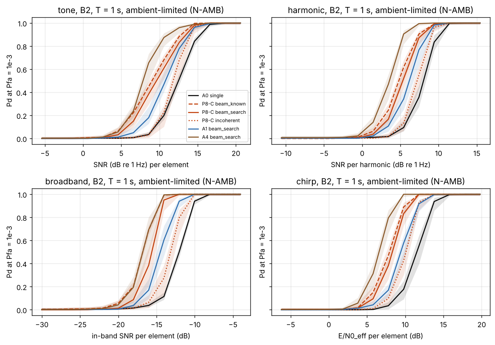
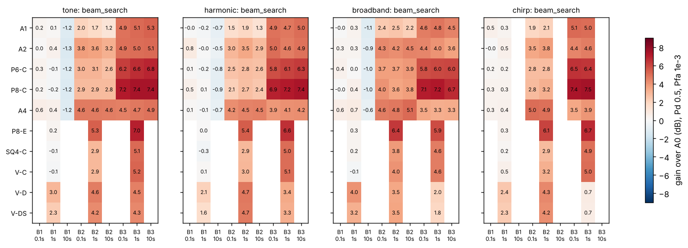
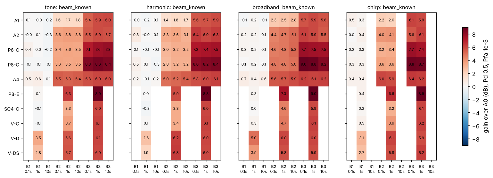
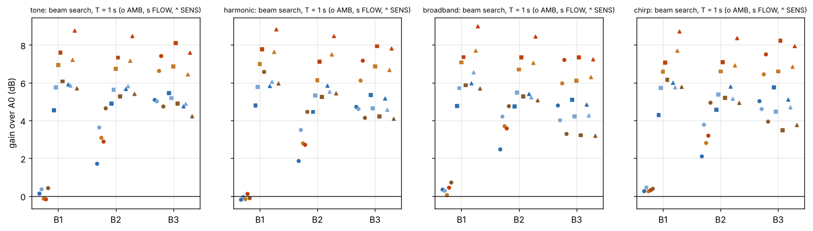
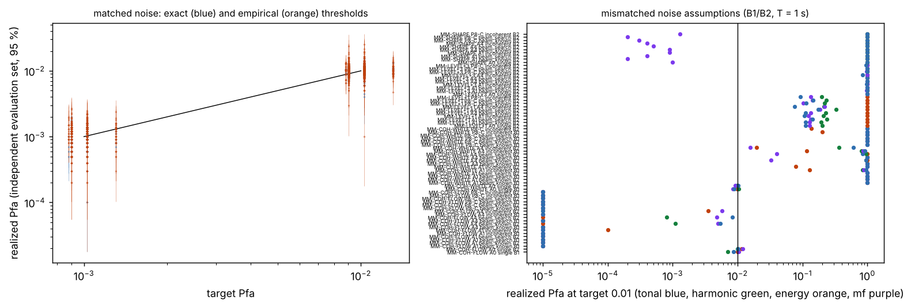
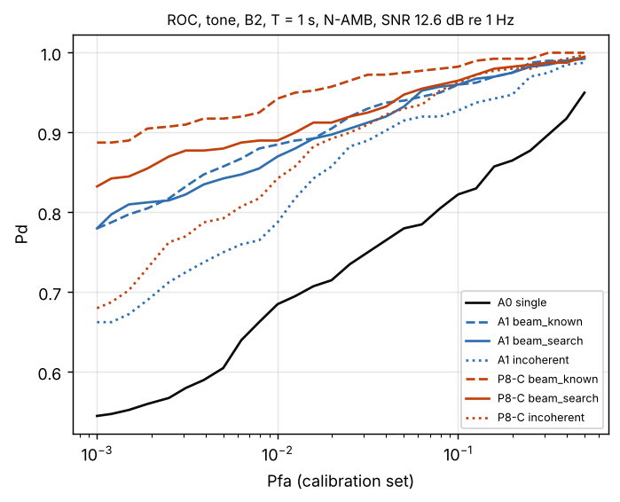
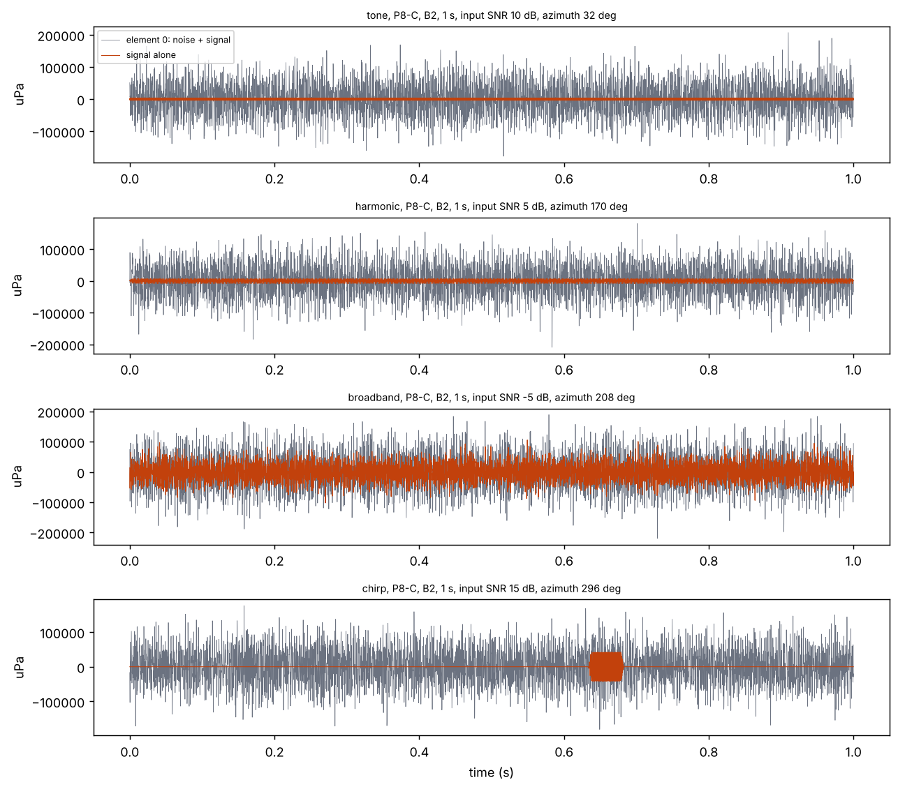

# PCK-SIM-001 / SIM-02B.1 Engineering Report

**Signal and Detection-Model Foundation: Detection Benefit of Candidate Arrays over a Single Hydrophone**

| | |
|---|---|
| Program | Ulmo / Picket, PCK-SIM-001 |
| Increment | SIM-02B.1 (signal and detection-model foundation), authorized by the SIM-02A technical review (ADR-0014) |
| Run of record | `20261108T125126Z_1c70e065_8dbe019` (139 cases, 5,907 s on 4 worker processes) |
| Code | `picket_sim` 0.1.0, git `8dbe019` (clean tree); Python 3.13.18, NumPy 2.5.4 |
| Configuration | `configs/sim02b/sim02b1_baseline.yaml` (sha256 `1c70e065c1425868...`) |
| Reproduce | `make sim02b1` (about 100 minutes on 4 cores); claims: `make sim02b1-claims` |
| Status | Revision 0. Submitted for review of numerical results. SIM-02B.2 not begun (ADR-0014). No architecture selected; no detection range estimated. |

All numbers are read from `results/sim02b1/20261108T125126Z_1c70e065_8dbe019/tables/` or computed from them by
`tools/sim02b1_summary.py` (`reports/SIM-02B1_summary_tables.md`) and `tools/sim02b1_calibration_check.py`
(`reports/SIM-02B1_calibration_check.md`); `tools/check_sim02b1_claims.py` rechecks every number quoted here.
**Noise levels and shapes follow a published Wenz-type envelope with assumed shipping and wind parameters;
spatial coherence, sensor self-noise, signal classes and detector settings are assumed** (2 published records,
0 measured, 23 assumed; `tables/parameters_by_provenance.csv`). Results are input-SNR ratios at one element
(ADR-0015) and transfer to other absolute levels as long as the noise coherence and spectral shape hold.

---

## 0. Findings

"Gain" is the detection gain over A0: the reduction in input SNR per element needed to reach Pd = 0.5 at
Pfa = 1e-3 per decision window, with 95 % intervals (ADR-0015). Statements use only cells whose thresholds are
exact or empirical; cells set by union bounds are conservative and are flagged where quoted.

1. **In ambient-limited, spherically isotropic noise from 20 to 200 Hz (B1), no candidate up to 1.07 m beats A0.**
   Over the five primary arrays, all four signal classes, the three processing modes and 0.1 s and 1 s windows,
   gains range from -0.2 to 0.8 dB, and 119 of 120 intervals contain zero. Beam search costs nothing here
   (beam-known minus beam-search difference -0.3 to 0.1 dB) because every beam of a compact array is nearly
   omnidirectional at these frequencies. Only the 4 m envelopes gain in B1 (V-D 2.1 to 4.0 dB, V-DS 1.6 to 3.2 dB,
   beam search, 1 s). (High, for the model; coherence assumed.)
2. **From 200 Hz to 2 kHz (B2) the arrays gain moderately; from 2 to 10 kHz (B3) they approach their white-noise
   limit.** With beam search, B2 gains are 1.5 to 5.0 dB (A1 1.5 to 2.5, A2 3.0 to 4.3, P6-C 2.5 to 3.7, P8-C 2.1
   to 4.0, A4 4.2 to 5.0 dB; 0.1 s and 1 s). In B3 (0.1 s) they are 3.5 to 7.4 dB, and with the direction known P8-C
   reaches 8.0 to 9.0 dB against its 9.03 dB white-noise limit. (High, for the model.)
3. **Searching for the direction costs 0.5 to 2.9 dB in B3**, mostly for the distributed A4, whose beams at 2 to 10
   kHz are narrower than the 15 deg search spacing (straddle loss). In B2 the cost is -0.4 to 1.2 dB. A finer beam
   set would recover part of it (Section 7).
4. **When sensor self-noise or short-correlation flow-like noise dominates, the arrays gain in every band.** At
   T = 1 s with beam search, B1 gains are 4.3 to 7.8 dB in flow-like noise and 5.7 to 9.0 dB in sensor-limited noise,
   against -0.2 to 0.7 dB in ambient-limited noise. The low-band value of an array therefore depends on which noise
   dominates at the sensors, which only measured multi-sensor data can settle (SIM-02A finding 1 reproduced at task
   level). (High, for the model.)
5. **Incoherent channel combining, which needs no synchronization, recovers less than beamforming:** 0.5 to 4.5 dB
   in ambient-limited B2 and 2.3 to 5.3 dB in B3 (0.1 s), and 3.1 to 6.8 dB in flow-like or sensor-limited B1 (1 s).
6. **False-alarm control requires the noise level to be known to well under 1 dB, for A0 and arrays alike.** With
   thresholds set for the assumed noise and a true level 1 dB higher, a 0.01 target becomes 0.075 to 0.332 for the
   tonal, harmonic and matched-filter detectors and 1.0 for the energy detector; at +3 dB every detector reaches
   0.844 to 1.0. Replacing the Wenz-type envelope by the SIM-02A power-law envelope (a shape error) drives the tonal,
   harmonic and energy detectors to 0.999 to 1.0. Clairvoyant normalization is therefore not a usable design: the
   SIM-02B.2 detectors must estimate noise from the data. (High.)
7. **A wrong coherence assumption breaks array false-alarm control while leaving A0 untouched.** Normalizing beams
   as if the noise were spatially white when it is isotropic sends every beam detector of A1, P8-C and A4 in B1 to a
   realized Pfa of 1.0 (A0: 0.009 to 0.01). Assuming isotropic noise when it is flow-like makes the arrays far more
   conservative than intended (realized 0.0 in B1). Coherence is the dominant unvalidated input of this study.
8. **Thresholds are calibrated.** On independent evaluation sets, exact-law thresholds give 2.8 % and empirical
   thresholds 3.8 % of two-sided p-values below 0.05 (exact predictive laws; Bonferroni-adjusted smallest p-values
   0.645 and 1.0). Union-bound thresholds are conservative: beam-search bounds realize a median of 0.20 of their
   target, and the incoherent eigenvalue bounds are so loose (median 0.00) that incoherent results at 10 s and in B3
   at 1 s are not informative at Pfa 1e-3.
9. **An array's gain can be compared directly with longer integration on A0.** For stationary tones in B2, A0 needs
   9.25 dB less input SNR per decade of window length, and for broadband signals 4.94 dB per decade; P8-C's beam-search
   gain at 1 s (2.9 dB for tones, 3.6 dB for broadband) equals integrating 2.06 and 5.36 times longer on A0. This
   comparison holds only for signals that stay stable over the longer window. (Moderate: derived from the tables.)

**Program reading (conditional).** Under the stated assumptions, additional sensors buy measurable detection only
above about 200 Hz in ambient-limited conditions, or in any band when sensor or flow noise dominates. Below 200 Hz in
diffuse ambient-limited noise a single hydrophone is as good as any candidate up to 1.07 m. These results include
no calibration, synchronization or host-noise effects (SIM-02B.2) and rest on an assumed coherence model; they are
not a basis for selecting an architecture.

---

## 1. Scope and gating

SIM-02B.1 implements the signal and detection-model foundation of the SIM-02B plan (`docs/SIM-02B_plan.md`): inputs
with provenance (D01), broadband signal generation, broadband multichannel acquisition with the SIM-02A sensor and
noise models, A0 and multichannel conventional detectors, threshold estimation, Monte Carlo evaluation and
verification. Bearing and TDOA estimation, synchronization models, joint calibration and noise errors and expanded
steering studies are SIM-02B.2 and have not started. No detection range, hardware requirement or architecture
selection is made.

## 2. Methods

Model documentation: `docs/detection_models.md`; decisions: ADR-0015 (SNR conventions, decision opportunities,
thresholds), ADR-0016 (synthesis), ADR-0017 (inputs).

* **Observation.** Windows of 0.1, 1 and 10 s (60 s coherent tonal in B1), simulated as exact DFT bins in the bands
  B1 20 to 200 Hz, B2 200 Hz to 2 kHz and B3 2 to 10 kHz. Noise bins are independent circular Gaussian vectors with
  the cross-spectral matrix of the scenario; signals are exact sampled-data DFTs; any trial can be rebuilt as a
  multichannel waveform (`waveforms/`, Figure 8).
* **Noise scenarios.** N-AMB: Wenz-type ambient (Stojanovic 2007, Eq. 6, citing Coates 1989; shipping 0.5, wind 5 m/s),
  spherically isotropic, S1 self-noise (ambient-limited). N-FLOW: same spectrum, exponential coherence with
  L = 0.1 m. N-SENS: isotropic ambient with self-noise 20 dB above it (sensor-limited). Mismatch truths: ambient +1 dB,
  +3 dB, the SIM-02A power-law envelope, flow-like coherence; mismatch assumption: spatially white.
* **Signals.** Tone; four equal-SNR harmonics; flat-spectrum broadband; Tukey-tapered LFM chirps (B1 50 to 150 Hz,
  80 ms; B2 0.5 to 1.5 kHz, 50 ms; B3 3 to 8 kHz, 50 ms), each a plane wave on the horizon from an azimuth drawn per
  trial. Input SNR conventions (one element, all noise): tone and harmonic in dB re 1 Hz per tone; broadband in-band;
  chirp E/N0_eff.
* **Processing.** A0 (one element); beam-known (DAS at the true azimuth, an upper bound); beam-search (24 DAS beams
  at 15 deg, maximum); incoherent (element powers averaged). Detectors: tonal maximum, harmonic sum, whitened energy,
  whitened matched filter with lag search. Every search (bins, fundamentals, lags, beams) is inside the window
  statistic; Pfa is per non-overlapping window.
* **Statistics.** Disjoint calibration, evaluation and positive trial sets (10,000 / 10,000 / 400 per case at 0.1 and
  1 s; fewer in B3 and at 10 s, `configs/sim02b/sim02b1_baseline.yaml`). Thresholds: exact law, else empirical
  order statistic when n_cal Pfa >= 10, else union bound. Pd intervals include the threshold's own uncertainty. SNR
  grids are placed from an analytic A0 operating point and are never extrapolated.

## 3. Results

### 3.1 A0 operating points

Input SNR per element that A0 needs for Pd = 0.5 at Pfa = 1e-3, ambient-limited noise (from `snr_required.csv`):

| Class (units) | B1 0.1 s | B1 1 s | B1 10 s | B2 0.1 s | B2 1 s | B2 10 s | B3 0.1 s | B3 1 s | B3 10 s |
|---|---|---|---|---|---|---|---|---|---|
| tone (dB re 1 Hz) | 20.7 | 11.7 | 2.2 | 21.7 | 12.5 | 3.2 | 22.1 | 13.0 | 3.9 |
| harmonic (dB re 1 Hz per harmonic) | 16.1 | 7.0 | -2.4 | 17.1 | 8.0 | -1.4 | 17.2 | 8.1 | -1.4 |
| broadband (dB in band) | -3.3 | -8.5 | -13.7 | -6.9 | -12.0 | -16.8 | -11.6 | -16.8 | -22.0 |
| chirp (E/N0_eff, dB) | 9.5 | 10.6 | | 10.8 | 11.5 | | 11.3 | 12.0 | |

The tone and harmonic requirements fall 9.25 dB per decade of window length in B2 (coherent integration with a
growing frequency search), the broadband requirement 4.94 dB per decade (energy integration); the chirp requirement
rises slightly with the window because the arrival-time search grows.

### 3.2 Gain over A0, ambient-limited noise

*Figure 1. Pd at Pfa = 1e-3 against input SNR per element, B2, 1 s windows, ambient-limited noise, with 95 % intervals.*

*Figure 2. Gain over A0 with beam search (dB, Pd = 0.5, Pfa = 1e-3), all candidates, ambient-limited noise. Cells for 10 s windows, B3 at 1 s and the secondary candidates in B3 use union-bound thresholds (conservative; `reports/SIM-02B1_summary_tables.md` marks them).*

*Figure 3. Gain over A0 with the beam at the true direction (upper bound on beamforming without search).*

Gain ranges over the four signal classes (exact or empirical thresholds only):

| Candidate | B1, 0.1 and 1 s, any mode | B2, beam search, 0.1 and 1 s | B2, beam known | B2, incoherent | B3, beam search, 0.1 s | B3, beam known, 0.1 s | B3, incoherent, 0.1 s |
|---|---|---|---|---|---|---|---|
| A1 | see Finding 1 | 1.5 to 2.5 | 1.4 to 2.5 | 0.5 to 0.9 | 4.6 to 5.1 | 5.4 to 6.1 | 3.0 to 4.0 |
| A2 | | 3.0 to 4.3 | 3.3 to 4.7 | 1.0 to 1.8 | 4.4 to 5.0 | 5.5 to 6.4 | 2.7 to 4.4 |
| P6-C | | 2.5 to 3.7 | 3.0 to 4.8 | 0.7 to 1.3 | 5.8 to 6.5 | 7.1 to 7.7 | 3.9 to 5.0 |
| P8-C | | 2.1 to 4.0 | 2.8 to 4.8 | 0.7 to 1.4 | 6.9 to 7.4 | 8.0 to 9.0 | 4.4 to 5.3 |
| A4 | | 4.2 to 5.0 | 5.0 to 6.0 | 1.5 to 4.5 | 3.5 to 4.5 | 5.8 to 6.4 | 2.3 to 4.7 |

* A4, the notional 1.07 m distributed layout, gains most in B2 because its aperture decorrelates isotropic noise at
  lower frequency; in B3 the compact eight-element circle leads because gain there approaches 10 log10 N.
* Gains change little with window length when the threshold method is the same: for tones with the direction known,
  A1 gains 1.6, 1.7 and 1.8 dB in B2 at 0.1, 1 and 10 s.
* Secondary candidates (1 s, beam search): P8-E behaves like P8-C shifted down an octave (B2 5.3 to 6.4 dB); SQ4-C and
  V-C behave like the four-element compact arrays; the 4 m envelopes gain in B1 (Finding 1) and fall behind in B3,
  where their beams are narrow and the search set is coarse.
* 60 s coherent tonal in B1 (beam known): -0.1 to 0.1 dB for every primary candidate; beam-search and incoherent
  figures at 60 s use bounds and are pessimistic.

### 3.3 Noise scenarios

*Figure 5. Gain over A0 with beam search at 1 s for ambient-limited (o), flow-like (s) and sensor-limited (^) noise.*

| Scenario (T = 1 s, primary candidates) | B1 beam search | B1 incoherent | B2 beam search | B2 incoherent | B3 beam search (Pfa 1e-2) |
|---|---|---|---|---|---|
| N-AMB ambient-limited | -0.2 to 0.7 | -0.2 to 0.4 | 1.7 to 4.9 | 0.6 to 4.1 | 3.1 to 7.4 |
| N-FLOW flow-like | 4.3 to 7.8 | 3.1 to 6.5 | 4.5 to 7.3 | 3.2 to 6.7 | 3.3 to 8.1 |
| N-SENS sensor-limited | 5.7 to 9.0 | 3.3 to 6.8 | 4.9 to 8.5 | 3.1 to 7.1 | 3.1 to 7.9 |

B3 at 1 s is shown at Pfa = 1e-2 because its 4,000 calibration trials support empirical thresholds only down to that
level. With the direction known, P8-C in sensor-limited noise gains 8.7 to 9.1 dB in B1 and B2, its white-noise limit.

## 4. False-alarm calibration

*Figure 6. Realized Pfa on independent evaluation sets: matched noise (left) and mismatched noise assumptions (right).*

**Matched noise.** Exact predictive tests (`reports/SIM-02B1_calibration_check.md`): 648 exact-threshold rows, 2.8 %
of p-values below 0.05; 1,460 empirical rows, 3.8 %; 3,324 bound rows (one-sided), 1.0 %. Bonferroni-adjusted smallest
p-values are 0.645, 1.0 and 0.203: no evidence of miscalibration. The run's own self-check figures for empirical
thresholds used an evaluation-only interval and overstate the scatter; `results/sim02b1/ERRATA.md` records this
(no result is affected).

**Union bounds.** Beam-search bounds realize a median 0.20 of their target and incoherent bounds 0.00, so Pd values
at bound-set thresholds understate performance. Single-stream bounds that coincide with exact laws realize a median
of 0.90 to 0.93 of target, as expected.

**Mismatched assumptions** (B2, and B1 for coherence; 1 s; target 0.01):

| Truth versus detector assumption | A0 | Arrays (A1, P8-C, A4), beams |
|---|---|---|
| Ambient +1 dB | tonal, harmonic, mf 0.112 to 0.203; energy 1.0 | tonal, harmonic, mf 0.075 to 0.332; energy 1.0 |
| Ambient +3 dB | 0.844 to 1.0 (all detectors and candidates) | same |
| SIM-02A power-law envelope instead of Wenz-type | tonal, harmonic, energy 0.999 to 1.0; mf 0.0 to 0.001 | same |
| Isotropic truth, white assumed | 0.009 to 0.01 | 1.0 in B1; 1.0 in B2 for A1 and P8-C; 0.033 to 1.0 for A4 in B2 |
| Flow-like truth, isotropic assumed | 0.007 to 0.012 | 0.0 in B1 and for A1 and P8-C in B2 |

The energy detector integrates thousands of bins, so a 1 dB level error moves its statistic by many standard deviations.
The matched filter's chirp band sits where the power-law envelope is below the Wenz-type one, so that shape error made
it more conservative rather than less.

*Figure 7. ROC curves from the calibration and positive sets, tone, B2, 1 s, ambient-limited noise.*

## 5. Verification

* **Tests:** 214 pass at the packaging baseline and 212 at the run's code commit `8dbe019` (logs in
  `05_verification/` of the review package), including 26 SIM-02B.1 model tests (signal DFTs, Parseval scaling, covariance against sample and Welch estimates,
  acquisition-chain referral and quantization, TDOA sign by cross-correlation, timing-error closed form, null laws,
  calibration, bound conservatism, beta-binomial predictive law) and 7 pipeline tests (configuration failures,
  provenance fields, common source parameters, identical results for 1 and 2 worker processes).
* **Run self-checks:** time-series cross-spectral density against the model for three scenarios and three
  geometries, worst median error 0.84 standard errors; waveform variance within 0.8 % of band power; clipping
  headroom at least 10.5 dB for the S1 chain; exact-threshold calibration (above).

*Figure 8. Rebuilt multichannel waveforms (element 0) for one trial of each class, P8-C, B2, 1 s.*

## 6. Limitations and unvalidated assumptions

* **Noise spectra (unvalidated):** Wenz-type envelope from a secondary source with no stated uncertainty; shipping
  and wind parameters assumed. Detection results are relative to total element noise and depend on the envelope only
  through its shape within each band and the ambient-to-self-noise ratio.
* **Spatial coherence (unvalidated, dominant):** isotropic, exponential and white models are assumptions. Findings 1,
  4 and 7 depend on them. No multi-sensor coherence measurement for Picket-like geometries was found.
* **Sensor transfer functions (unvalidated):** the S1 chain is assumed; no integrated hydrophone with a published
  self-noise spectrum was found (`docs/input_provenance_register.md`).
* **Host noise:** not modeled. **Synchronization and calibration errors:** not modeled (SIM-02B.2); beam-known and
  beam-search gains are upper bounds with respect to them.
* **Statistics:** stationary Gaussian noise; clairvoyant normalization except in mismatch tests; Pfa 1e-4 results
  rest on exact laws or bounds only; incoherent bounds are loose.
* **Signals and geometry:** horizon plane waves, no propagation, multipath or Doppler; the 24-beam search set
  undersamples the beams of the 1.07 m and 4 m layouts at high frequency.

## 7. Recommendations for SIM-02B.2 and the next modeling increment

1. **Adaptive noise estimation before anything else in SIM-02B.2.** Finding 6 shows that a 1 dB level error multiplies
   Pfa by 7.5 to 33 for narrowband detectors and saturates the energy detector. Add data-driven normalization (for
   example reference-bin or split-window estimates) and report gains with its estimation loss.
2. **Measured multi-sensor coherence.** The array benefit below 200 Hz is decided by coherence (Findings 1, 4, 7).
   A short collection with even four hydrophones at representative spacings would replace the dominant assumption.
3. **Beam sets tied to aperture.** Space search beams by beamwidth rather than a fixed 15 deg for the 1.07 m and 4 m
   layouts; report the straddle loss separately.
4. **Calibration trials sized for Pfa 1e-3 at every window**, or a validated tail-estimation method, so that 10 s and
   B3 results do not rest on bounds; replace the incoherent eigenvalue bound with an exact quadratic-form law.
5. **SIM-02B.2 as planned:** broadband bearing and TDOA, shared and distributed clocks, joint calibration and noise
   errors (including persistent errors), at least 24 azimuths plus worst-case directions, compact against extended
   layouts.
6. **System-level trade:** express each candidate's gain as the equivalent A0 integration time (Finding 9) next to its
   size, power, calibration and synchronization burden; this is the comparison the program objective asks for.

## Appendix A. SIM-02A closeout and reviewer decisions

* **D06 criteria (SIM-02A run of record).** `reports/SIM-02A_criteria_D06.md`: with the nominal criterion at exactly
  -6.00 dB, the six-element circles' (P6-C, P6-E) guaranteed band ratio is 2.37; at -6.0206 dB (half amplitude) it is
  1.73, and at -6.5 dB 1.55. Between -5 and -7 dB their ratio falls from 2.42 to 1.48; the eight-element circles fall
  from 2.93 to 2.72 and every other candidate with a guaranteed band changes by at most 0.07. The volumetric
  envelopes and A4 have no guaranteed band anywhere between -5 and -7 dB.
* **D05 acoustic vector sensors.** `docs/avs_feasibility.md` Section 6: conditional go for a limited bench test
  (moderate confidence); no purchase or collection was made.
* **D01 inputs.** `docs/input_provenance_register.md`, with evidence in `docs/research/`.
