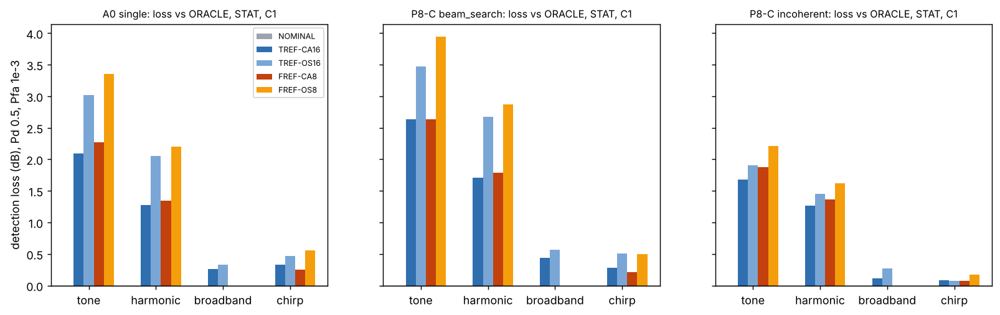
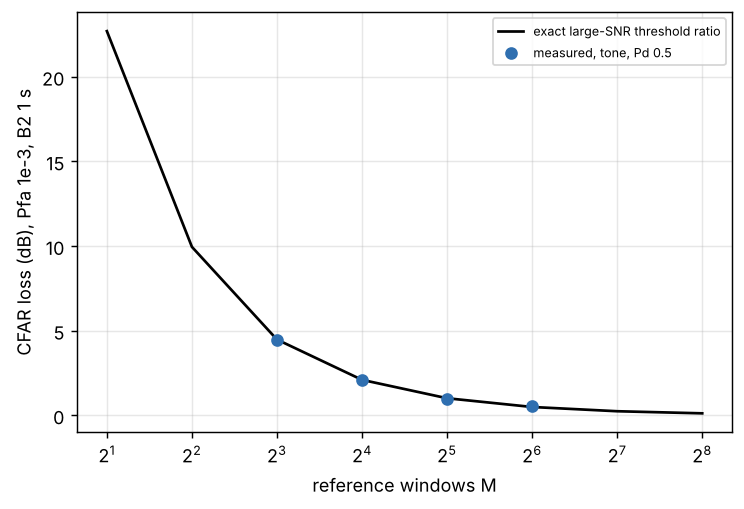
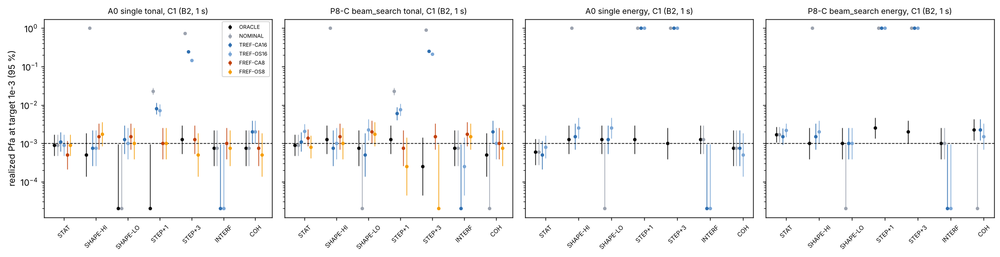
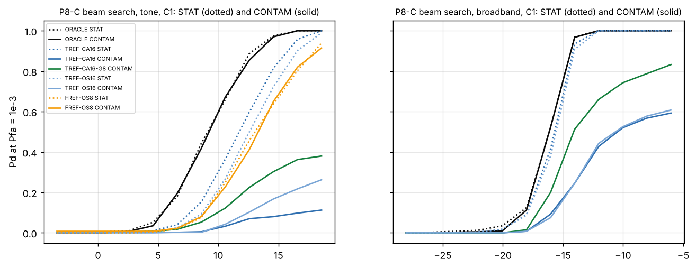

# PCK-SIM-001 / SIM-02B.2-A Engineering Report

**Adaptive Noise Estimation and False-Alarm Control**

| | |
|---|---|
| Program | Ulmo / Picket, PCK-SIM-001 |
| Increment | SIM-02B.2-A (adaptive noise estimation), authorized by the SIM-02B.1 review (ADR-0018; decisions ADR-0019, ADR-0020) |
| Run of record | `20261109T003718Z_27abcd69_73fbe35` (12 calibration and 48 evaluation cases, 8,172 s on 4 worker processes) |
| Code | `picket_sim` 0.1.0, git `73fbe35` (clean tree); Python 3.13.18, NumPy 2.5.4 |
| Configuration | `configs/sim02b/sim02b2a_baseline.yaml` (sha256 `27abcd691b9aeefc...`), generated by `tools/make_sim02b2a_config.py` |
| Reproduce | `make sim02b2a` (about 2.3 hours on 4 cores); claims: `make sim02b2a-claims`; partial rerun: `make sim02b2a-repro-check` |
| Status | Revision 0. Submitted at the SIM-02B.2-A review gate. SIM-02B.2-B and -C not begun. No architecture selected; no detection range estimated; no hardware requirement derived. |

All numbers are read from `results/sim02b2a/20261109T003718Z_27abcd69_73fbe35/tables/` or computed from them by
`tools/sim02b2a_summary.py` (`reports/SIM-02B2A_summary_tables.md`), `tools/sim02b2a_supplement.py`
(`reports/SIM-02B2A_supplement.md`) and `tools/sim02b2a_b1_regression.py` (`reports/SIM-02B2A_b1_regression.md`);
`tools/check_sim02b2a_claims.py` rechecks every number quoted here. **The noise is stationary circular Gaussian inside
every window; spectra follow the published Wenz-type equations with assumed shipping and wind values; coherence,
sensor self-noise, signal classes, scenario parameters and normalizer settings are assumed** (4 published records, 0
measured, 27 assumed; `tables/parameters_by_provenance.csv`). Results are input-SNR ratios at one element (ADR-0015).
No operational conclusion is drawn from them (review requirement): real ambient noise is nonstationary, sometimes
impulsive, and its coherence at Picket sites is unmeasured.

---

## 0. Findings

Operating point unless stated: cell C1 (200 Hz to 2 kHz, 1 s windows), Pfa 1e-3 per decision window, Pd 0.5,
thresholds fixed at design time under the nominal model. Confidence statements refer to the simulation model, not to
the ocean.

1. **False-alarm control with estimated backgrounds is demonstrated under the nominal design for every normalizer,
   candidate, cell and Pfa (high confidence).** Across 1,170 evaluation rows of stationary nominal noise, the exact
   predictive test of each realized false-alarm count gives 4.3 % of two-sided p-values below 0.05 and no tail
   probability below 0.001 in either direction (Bonferroni-adjusted smallest p-value 1.0). Thresholds come from exact
   laws, an exact-in-distribution fast simulation (A0), the exact quadratic-form law and conditional Monte Carlo
   (ORACLE arrays), and sequential empirical calibration (adaptive arrays). The two tail methods agree with
   independent empirical thresholds in 33 of 36 statistics, the largest difference 0.206 dB. At Pfa 1e-4, array
   thresholds without an exact or tail method (every adaptive normalizer, and ORACLE and NOMINAL for the energy,
   harmonic and matched-filter statistics) were not bought (D06 budget) and are reported as not estimated.
2. **Estimating the background costs tonal detection 2.10 dB on A0 and 2.51 to 2.63 dB with beam search, but
   broadband energy detection only 0.11 to 0.47 dB (high confidence).** These are cell-averaging estimates over 16
   reference windows; averaging 16 neighbouring bins costs about the same (2.27 dB on A0, 2.63 to 2.80 dB with beam
   search). Order-statistic estimators, which tolerate outliers, cost more for tones on A0 and with beam search: 3.02
   to 3.47 dB from reference windows and 3.35 to 3.94 dB from reference bins. The A0 loss follows the exact CFAR law: for 8 to 64 reference
   windows the measured and exact losses agree within 0.13 dB in all three cells, and doubling the window count
   roughly halves the loss (C1: 4.48, 2.10, 1.01 and 0.50 dB for 8, 16, 32 and 64 windows). The loss grows as the
   false-alarm target tightens (A0 tone: 1.78, 2.10 and 2.39 dB at Pfa 1e-2, 1e-3 and 1e-4).
3. **The array advantage over A0 survives background estimation (high confidence within the model).** With the same
   adaptive normalizer on A0 and on the array, beam-search gains for tonal and harmonic signals fall by 0.19 to 0.94
   dB relative to the ORACLE gains, and broadband and chirp gains change by -0.33 to 0.18 dB (C1 and C3). P8-C beam
   search keeps 2.83 to 3.05 dB of its 3.42 dB tonal gain and 4.06 to 4.12 dB of its 4.30 dB broadband gain in C1.
   Incoherent combining gains more relative to A0 than with ORACLE normalization (tones: 0.13 to 1.80 dB more),
   because A0 pays a larger estimation loss. Below 200 Hz (C2) every adaptive gain lies between -0.26 and 0.72 dB:
   no compact candidate beats A0 there, as in SIM-02B.1.
4. **Time references and frequency references fail in opposite conditions (high confidence for the mechanisms;
   the sizes depend on the assumed scenario parameters).**
   * *Level change.* A test window only 1 dB above its reference windows multiplies the tonal false-alarm rate of
     time-reference normalizers by 3.50 to 11.25 at Pfa 1e-3, and drives the energy detector to Pfa 1.0. A 3 dB step
     multiplies the tonal rate by 106 to 355. Frequency references, estimated inside the test window, show no flagged row in
     either step scenario.
   * *Intermittent interference in reference windows* (probability 0.25, 10 dB above ambient) inflates time-reference
     estimates by 4.55 to 5.02 dB on average (cell averaging) and 3.15 to 3.84 dB (order statistic). False alarms
     fall to 0 to 0.17 of the target at Pfa 1e-2 (every row flagged conservative) and tonal detection loses a further 4.52 to 5.42 dB (cell averaging) or 1.95 to 2.83 dB (order
     statistic) relative to stationary noise; broadband detection with time references fails to reach Pd 0.5 in 12
     of 14 rows. Frequency references are unaffected (-0.18 to 0.26 dB relative to stationary noise).
   * *Target in the reference windows.* A persistent tone masks itself in every time-reference estimate. Pd never
     reaches 0.5; at the top of the SNR grid it is 0.11 to 0.13 with a 2-window guard and 0.38 to 0.39 with an
     8-window guard, the fraction of trials whose reference windows are clean (0.11 and 0.38 for the run's onset
     draws). Frequency references are unaffected for tones (-0.26 to 0.46 dB). For broadband targets, time references
     need 4.59 to 5.65 dB more SNR than in stationary noise; the 8-window guard reduces this to 1.59 to 1.95 dB.
   * *Spectral shape and overall level* (D03 high and low conditions): every adaptive normalizer holds false-alarm
     control; the fixed design model saturates (Pfa 1.0) or goes silent and then costs 5.05 to 5.29 dB for tones.
5. **No background-level estimator repairs a coherence mismatch (high confidence for the mechanism).** With
   flow-like noise under the isotropic design, the threshold law of multichannel statistics is wrong, not the level.
   For incoherent combining, 121 of 132 rows at Pfa 1e-2 produce no false alarm in 4,000 trials, for every
   normalizer including ORACLE (the design threshold is far too high, which also costs detection). Beam search runs
   above target instead: at Pfa 1e-2 up to 2.93 times (A4, 20 to 200 Hz). Coherence must be known (D02) or the
   threshold law calibrated from data before multichannel thresholds can be trusted.
6. **Per-window Pfa and false alerts per hour are different quantities.** One detector on non-overlapping 1 s windows
   at Pfa 1e-3 raises 3.6 false alerts per hour (36 with 0.1 s windows; 0.36 at Pfa 1e-4). A system running several
   detectors in parallel accumulates their alerts. Every Pfa in this report is per window and per detector statistic
   (the beam-search statistic already includes the maximum over beams and bins).
7. **The ORACLE results reproduce SIM-02B.1.** In 343 of 348 comparable rows the SNR required agrees within the
   combined 95 % uncertainty of the two independent runs (5 marginal, none inconsistent). Where SIM-02B.1 used union
   bounds (Pfa 1e-4 for multichannel statistics), the bounds held in 48 of 48 rows and overstated the SNR required by
   up to 3.53 dB (median 0.65 dB): those SIM-02B.1 rows were conservative, as labeled.

## 1. Scope and gating

Authority: SIM-02B.1 review and SIM-02B.2 authorization (ADR-0018): D01 adaptive noise estimation is the first
activity; SIM-02B.2-B (broadband detection and bearing) and -C (timing and calibration) begin only after this
review. **Gap against D01:** D01 asked to compare reference-window, reference-bin and robust multichannel covariance
estimation. The first two are done. The third is not: beam-domain cell-averaging time references equal w^H S_hat w for the
conventional weights w and the sample covariance S_hat of the reference windows, but no robust covariance estimator
(shrinkage, outlier rejection), covariance whitening or covariance-adaptive beamformer was tested. Its completion is a
decision requested in the transmittal. Not in scope: bearing, synchronization, calibration error, host noise, non-Gaussian noise, the D07
aperture-aware beam grid (the 24-beam regression grid is kept), and any architecture, range or hardware conclusion.

## 2. Methods

**Normalizers** (ADR-0019; `src/picket_sim/noise_estimation.py`). Statistic inputs u_k = |y_k|^2 / G_hat_k per stream
(A0 element, beam or element) and bin, then the SIM-02B.1 detectors.

| ID | Background estimate | Data used |
|---|---|---|
| ORACLE | true background of the test window (upper bound only) | ground truth |
| NOMINAL | fixed design model (Wenz nominal, isotropic) | none |
| TREF-CA16 | mean of 16 reference-window powers after a 2-window guard (8 for TREF-CA16-G8 in CONTAM) | past windows |
| TREF-OS16 | 12th smallest of the same 16 powers | past windows |
| FREF-CA8 | mean of 8 bins on each side after a 2-bin guard (one-sided at band edges) | test window |
| FREF-OS8 | 12th smallest of the same 16 bins | test window |

Frequency references are not combined with the energy detector: a broadband signal fills its own reference bins.
A0 is also run with 4, 8, 32 and 64 reference windows. Adaptive normalizers receive data arrays only; a test feeds
NaN as the model background and confirms that adaptive statistics are unchanged (ground-truth isolation).

**Partitions.** Calibration, evaluation-null and positive trials use separate seed streams; reference windows are
generated inside each trial; thresholds are calibrated once under the nominal design and then held fixed in every
scenario (scenarios change the truth only). Detectors never see ground truth.

**Threshold calibration** (ADR-0020), in order of preference: exact CFAR laws (cell averaging (1 + eta/M)^-M; order
statistic product form; maximum over independent bins); exact-in-distribution fast null simulation for A0 (100,000
samples; reference estimates drawn from their Gamma and Beta laws); exact quadratic-form law for ORACLE incoherent
tonal statistics (hypoexponential survival by matrix exponential); conditional Monte Carlo for the ORACLE beam-search
tonal maximum (95 % precision 0.0007 to 0.007 dB); sequential empirical calibration for adaptive arrays (batches of 2,000,
stop when the Pfa 1e-3 interval is within 0.25 dB or at 20,000 trials; every array case ran to the cap, as
projected in the measured budget). Adaptive array thresholds at Pfa 1e-3 have 95 % intervals with medians of 0.26
to 0.40 dB per candidate and cell (maximum 0.74 dB).

**Scenarios** (C1 unless noted): STAT (all cells); SHAPE-HI and SHAPE-LO (shipping 1.0 and wind 10 m/s; shipping 0.0
and wind 2.5 m/s); STEP+1 and STEP+3 (test window above its references; STEP+3 also in C2); INTERF (each reference
window independently holds, with probability 0.25, a plane-wave Gaussian interferer 10 dB above ambient); COH
(flow-like coherence truth, C1 and C2); CONTAM (target onset 0 to 24 windows before the test window, tone and
broadband; guard 2 and 8). Noise-only trials: 10,000 (STAT) or 4,000; positive trials: 400 per SNR point.

**Uncertainty is reported separately** for false alarms (Wilson interval and exact predictive test of the realized
count), thresholds (order-statistic interval or method precision, in dB) and detection (binomial interval of Pd, and
the Pd range induced by the threshold interval). In STAT C1 at Pfa 1e-3 and Pd 0.5, the binomial interval of the SNR
required has a median width of 0.43 dB (maximum 1.07 dB); the interval induced by empirical thresholds has a median
width of 0.34 dB (maximum 0.93 dB). Detection loss = SNR required with the normalizer minus SNR required with
ORACLE, same candidate, mode, class, scenario and trials. A loss obtained at a liberal realized Pfa is not a
detection result and is marked in the tables.

## 3. Results

### 3.1 Threshold calibration and the stationary false-alarm test

Methods used (`reports/SIM-02B2A_summary_tables.md` S1): exact 90 rows, fast null simulation 252, exact quadratic
form 54, conditional Monte Carlo 54, sequential empirical 720, not estimated 360 (arrays at Pfa 1e-4: 252 adaptive
rows and 108 ORACLE and NOMINAL rows for statistics other than the tonal maximum). The
exact predictive test (S2) is binomial for exact and tail-method thresholds and beta-binomial for empirical and
fast-simulation thresholds, which carries the threshold's own sampling error. Every normalizer passes; the largest
share of p-values below 0.05 is TREF-OS16 with 8.3 % of 180 correlated rows (smallest upper-tail p-value 0.0018).
The run's own `pfa_status` column used a Wilson interval instead and over-flags small counts (ERRATA); the report
does not use it.

### 3.2 Cost of estimation in stationary noise

*Figure 1. Detection loss against ORACLE, C1, Pfa 1e-3, Pd 0.5 (frequency references are not used with the energy
detector).*

Tonal and harmonic statistics take the maximum over many cells (up to 24 beams times 1,801 bins), so each cell needs
a very low false-alarm probability, and the CFAR loss of an estimate from 16 powers is large there. Statistics that
sum over many bins (energy, matched filter) average the estimation noise and lose little. Incoherent combining loses
less than beam search (1.16 to 1.74 dB for tones), consistent with two effects: its maximum runs over bins only, not
over beams and bins, and independent per-element estimation errors partly average out across elements. At Pd 0.9 the tonal losses are 1.08 to 2.91 dB (TREF-CA16) and 1.59 to 3.16 dB
(FREF-CA8). The background estimators behave exactly as their laws predict: in every scenario where reference and
test windows share one noise law, the measured bias and spread of the estimate equal the law (cell averaging over 16
powers -0.137 dB and 1.103 dB; 12th of 16 +0.923 dB and 1.359 dB; supplement Section 1).

*Figure 2. A0 tonal CFAR loss against the number of reference windows, C1: exact law (line) and measured (points).
M = 4 is beyond the SNR grid (exact 9.95 dB).*

### 3.3 Gain over A0 with estimated backgrounds

Summary tables S9 give gains with each normalizer; Section 0 item 3 states the ranges. With beam search, the ranking
of the three arrays by gain is the same with every normalizer as with ORACLE, for every class in C1 and C3. With
incoherent combining it is not always (A1 and P8-C swap places where their gains differ by less than the uncertainty).

### 3.4 Robustness by scenario

*Figure 3. Realized Pfa at target 1e-3 by scenario, C1, with 95 % Wilson intervals; zero counts are plotted at 2e-5.*

Level steps: the SIM-02B.1 finding that a 1 dB level error breaks false-alarm control applies equally to a stale
time reference. The energy detector, which sums 1,801 bins, cannot tolerate even a 1 dB step with any normalizer
that does not see the test window. Frequency references track the test window and hold. Interference: the order
statistic reduces the extra tonal loss of cell averaging but does not remove it: with probability 0.25 per window,
more than the 4 disturbed windows that the 12th of 16 tolerates occur in 37 % of trials (supplement Section 3). Shape: adaptive normalizers
track both the level and the shape changes; the fixed design model does not.

### 3.5 Coherence mismatch

Under the COH truth the per-stream level is known to ORACLE and estimated correctly by the adaptive normalizers
(estimation error equal to the stationary law), yet incoherent statistics are silent and beam search runs high. The
threshold of a multichannel statistic depends on the correlation between streams: decorrelated elements make the
average of their powers less variable (incoherent threshold too high), and decorrelated beams make the maximum over
beams more extreme (beam-search threshold too low). The SIM-02B.1 white-coherence mismatch showed the same mechanism
with ORACLE normalization; this run shows that adaptive level estimation does not help.

### 3.6 Target contamination

*Figure 4. P8-C beam search, C1: Pd in stationary noise (dotted) and with the target present in reference windows
(solid). Left: tone (x axis tone SNR per element, dB re 1 Hz). Right: broadband (in-band SNR per element, dB).*

The ceiling is exact: a contaminated cell-averaging estimate contains the tone power in the very bin being tested, so
the normalized statistic cannot exceed the threshold however strong the tone. The order statistic tolerates up to 4
contaminated windows, so its ceiling is the clean fraction 0.285; the measured Pd at the top of the grid is 0.225 to
0.2825 (supplement Section 2).

### 3.7 Processing cost

Per stream-bin on this machine (indicative): 7.33 ns (TREF-CA16), 24.70 ns (FREF-CA8), 109.92 ns (TREF-OS16) and
254.71 ns (FREF-OS8), all with 16 operations; time references hold 18 windows of history per stream, frequency
references none. Order statistics cost an order of magnitude more than averages in this implementation.

## 4. Verification

* **Tests:** 35 tests cover this increment (estimators against direct computation, exact CFAR laws against
  simulation, hypoexponential survival against closed forms, conditional Monte Carlo against brute force,
  ground-truth isolation, interference and contamination generators against their definitions, tone phase
  continuity against time-domain synthesis, fast null simulation against full synthesis, the stopping rule,
  worker-count independence, the exact predictive tails and the supplementary tools). The full suite passes at the
  packaging baseline (count in the transmittal).
* **Run self-checks:** stationary calibration (finding 1); ORACLE tail methods against empirical thresholds.
* **Regression against SIM-02B.1:** finding 7 (`reports/SIM-02B2A_b1_regression.md`).
* **Partial reproduction:** `tools/sim02b2a_repro_check.py` recomputes two calibration cases and three evaluation
  cases from the resolved configuration and compares every table row with the run as text; all rows are identical.
* **Exact laws in the run:** A0 measured CFAR loss against the exact law (Figure 2); estimator bias and spread
  against their laws; contamination ceilings against the onset draws.

## 5. Limitations and unvalidated assumptions

* Stationary circular Gaussian noise inside every window; no impulsive, biological or transient noise. Real
  false-alarm rates at 1e-3 and below are typically set by non-Gaussian tails, which this model cannot show.
* The STEP, INTERF, SHAPE and CONTAM parameters are assumed. They bracket mechanisms; their sizes are not site
  statistics. The D02 plan adds measurements that would replace them.
* Coherence is assumed (isotropic nominal, exponential 0.1 m flow-like): finding 5 makes this the dominant open input.
* Adaptive array thresholds, and ORACLE array thresholds for statistics other than the tonal maximum, exist only at
  Pfa 1e-2 and 1e-3.
* The 24-beam regression grid is kept; its straddle loss is part of every beam-search number (D07 is SIM-02B.2-B).
* Processing cost is indicative of this NumPy implementation only.
* Robust multichannel covariance estimation (D01) was not tested (Section 1).

## 6. Engineering assessment and recommendations for SIM-02B.2-B (for decision)

The exit requirement of this stage (false-alarm control with estimated backgrounds, detection loss quantified
against A0 and ORACLE) is met within the stated model. Three points should shape SIM-02B.2-B:

1. No single background estimator is robust to all tested conditions: frequency references survive level changes,
   interference and persistent tones but cannot serve broadband statistics; time references serve broadband
   statistics but fail on level changes, interference and persistent targets. SIM-02B.2-B should carry both, with a
   larger guard for time references, and report their combination rather than choose one now.
2. Multichannel thresholds need the noise coherence or a data-driven threshold law (for example, calibrating the
   threshold of each stream combination from reference windows). Without it, array false-alarm control is not
   demonstrated outside the design coherence.
3. Gains should continue to be reported net of estimation loss, with A0 using the same normalizer.

Decisions requested are listed in the transmittal (Section 7).

## Appendix A. Other reviewer decisions in this stage

* **D02:** `docs/coherence_collection_plan.md` (plan only) with design tables in `reports/SIM-02B2A_d02_design.md`.
* **D03:** Wenz nominal retained; SHAPE and STEP scenarios run; provenance kept.
* **D04:** deferred to SIM-02B.2-C as authorized.
* **D05:** loaned-sensor bench evaluation outline added (`docs/avs_feasibility.md` Section 7); no purchase.
* **D06:** measured compute budget and priorities in `docs/SIM-02B2A_plan.md` Sections 6 and 7; exact laws, tail
  methods and sequential calibration used; bounds labeled; the 139 SIM-02B.1 cases were not scaled.
* **D07:** deferred to SIM-02B.2-B; the 24-beam grid is kept for regression.
